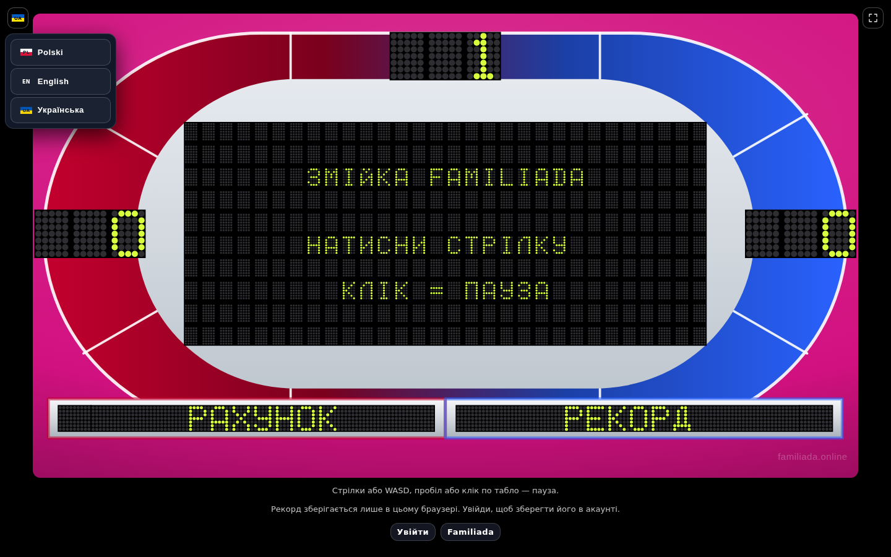
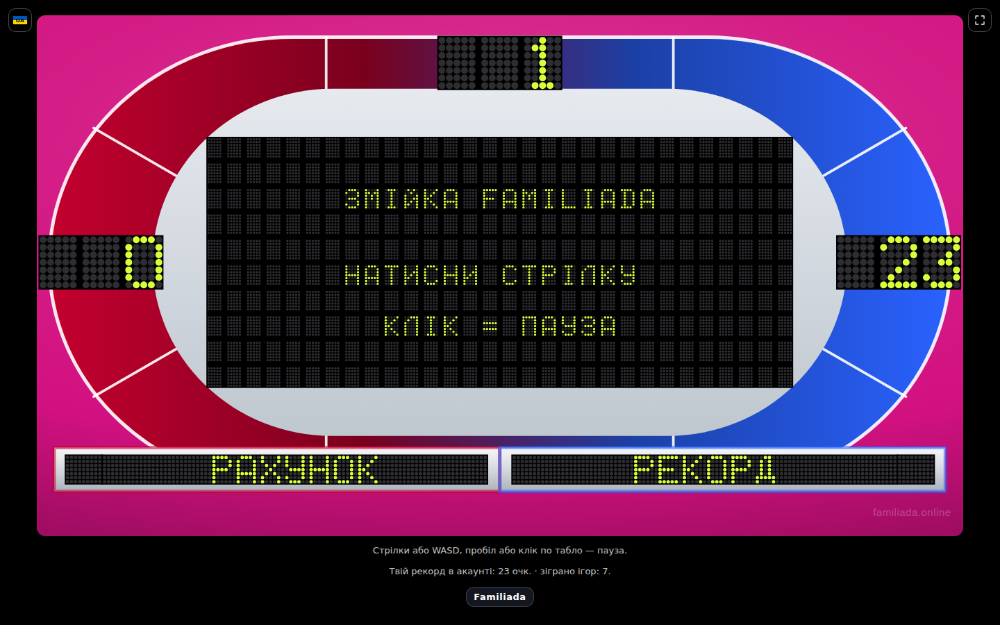
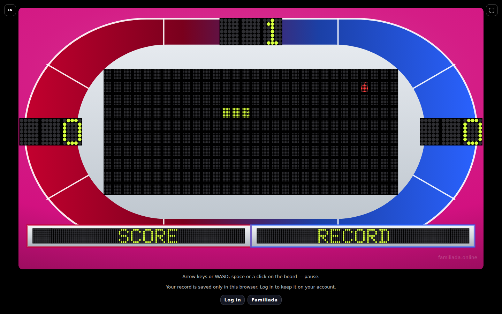

# Zrzuty — 2026-10-20 18:14 UTC

### Ukryta gra w węża — przełącznik języka (menu otwarte) — pl · desktop

### Ukryta gra w węża — przełącznik języka (menu otwarte) — en · desktop

### Ukryta gra w węża — przełącznik języka (menu otwarte) — uk · desktop

### Ukryta gra w węża — start (telefon w pionie: prośba o obrót) — pl · desktop

### Ukryta gra w węża — start (telefon w pionie: prośba o obrót) — pl · phone

### Ukryta gra w węża — start (telefon w pionie: prośba o obrót) — en · desktop

### Ukryta gra w węża — start (telefon w pionie: prośba o obrót) — en · phone

### Ukryta gra w węża — start (telefon w pionie: prośba o obrót) — uk · desktop

### Ukryta gra w węża — start (telefon w pionie: prośba o obrót) — uk · phone

### Ukryta gra w węża — rozgrywka (bez konta) — pl · desktop

### Ukryta gra w węża — rozgrywka (bez konta) — en · desktop

### Ukryta gra w węża — rozgrywka (bez konta) — uk · desktop

