# Zrzuty — 2026-10-29 13:57 UTC

### Ustawienia wyglądu — pl · desktop

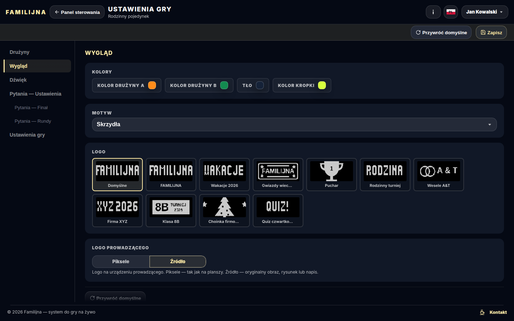

### Prowadzący — runda — pl · desktop

### Wyświetlacz — runda — pl · desktop

### Panel sterowania — podsumowanie — pl · desktop

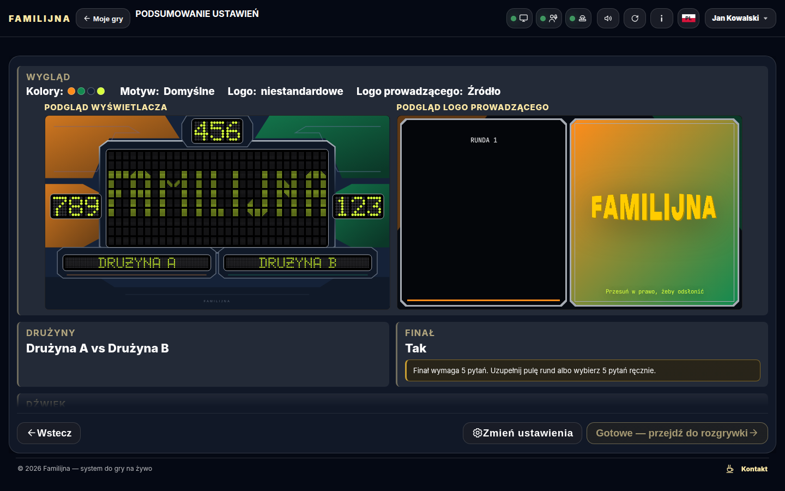

### Główny Wyświetlacz — pl · 1600×900

### Podgląd linku (og:image) — pl · 1200×630

### Ustawienia gry — wygląd i logo Prowadzącego — pl · desktop

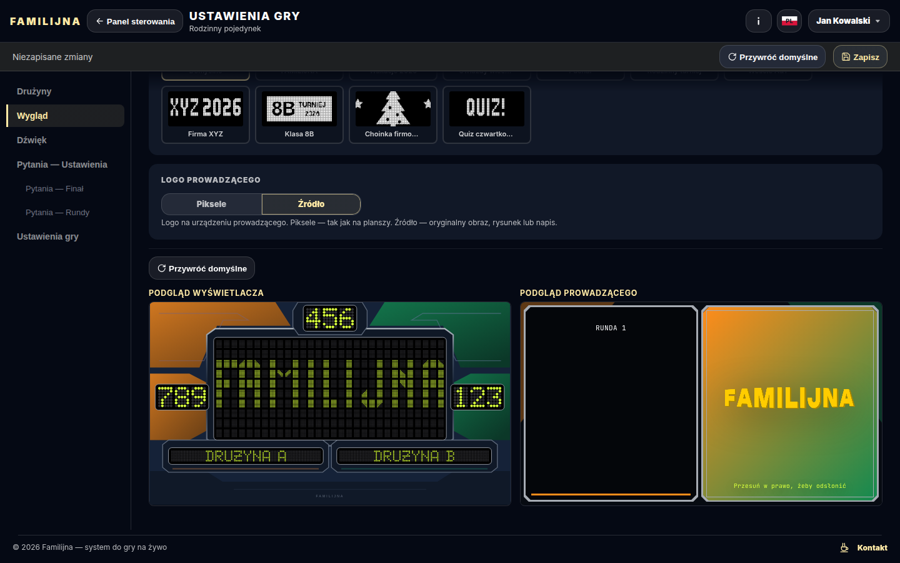

### Ustawienia gry — wygląd i logo Prowadzącego — pl · phone

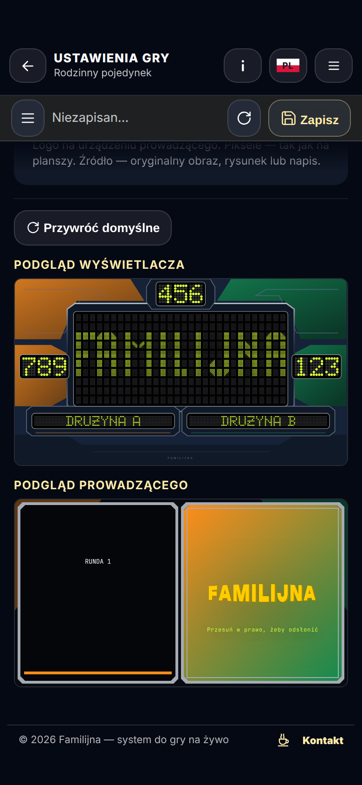

### Ustawienia gry — podgląd Prowadzącego w motywie nowoczesnym — pl · desktop

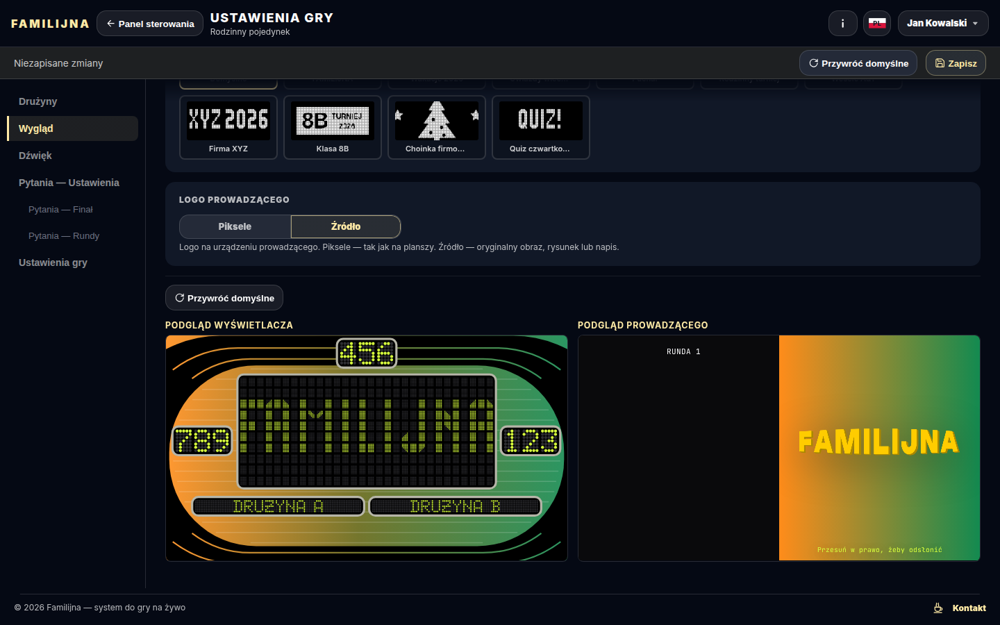

### Ustawienia gry — podgląd Prowadzącego w motywie nowoczesnym — pl · phone

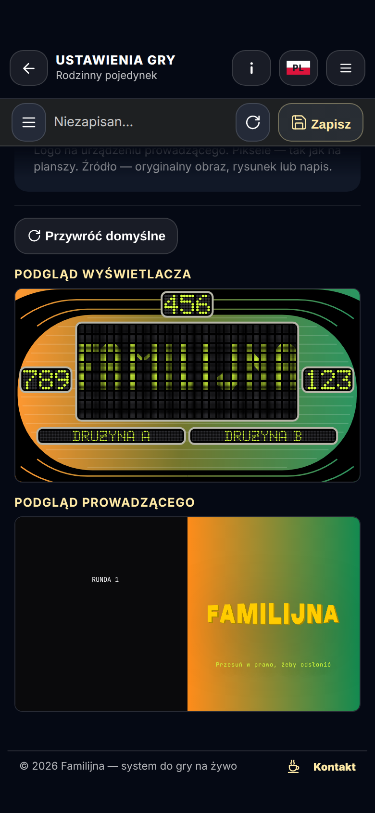

### Ustawienia gry — logo domyślne w trybie Piksele — pl · desktop

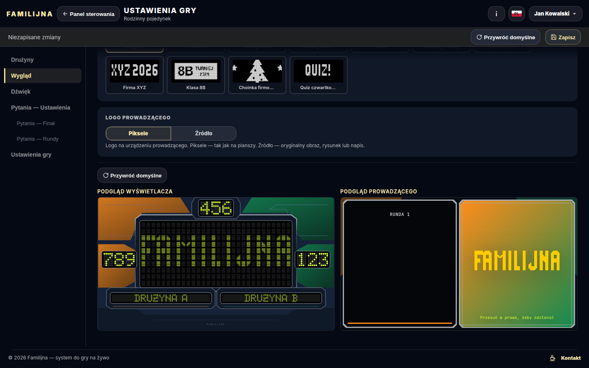

### Ustawienia gry — logo domyślne w trybie Piksele — pl · phone

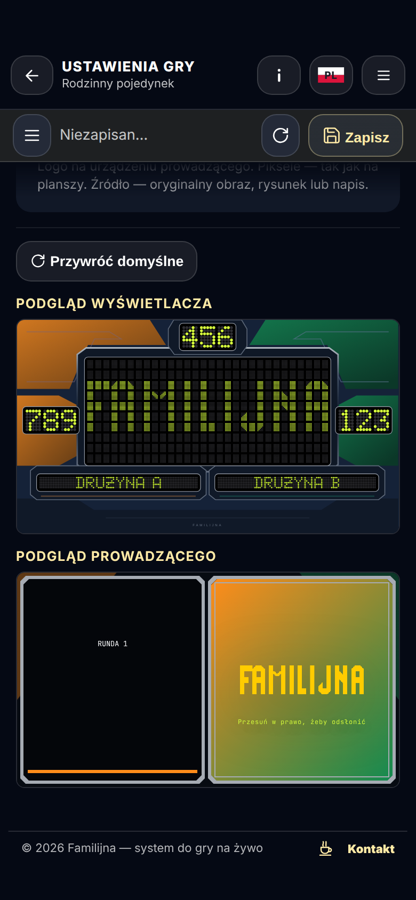

### Wyświetlacz — niskie okno komputera (1400×550): Za małe okno — pl · 1400×550

### Prowadzący — classic — pl · phone

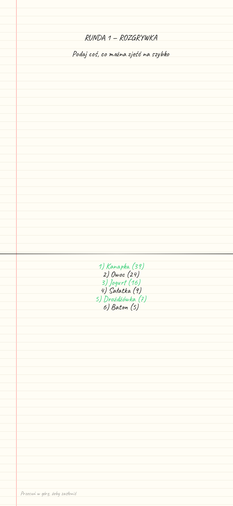

### Prowadzący — classic — zasłona — pl · phone

### Prowadzący — wings — pl · phone

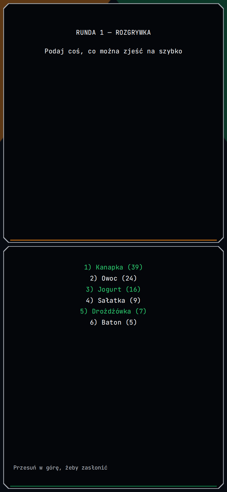

### Prowadzący — wings — zasłona — pl · phone

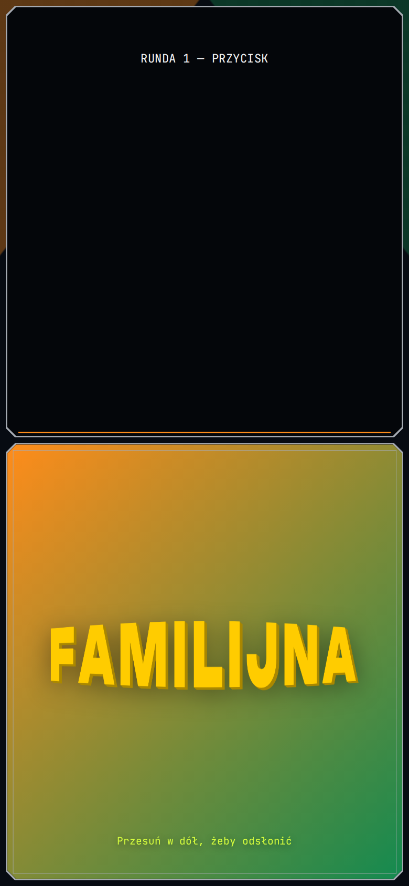

### Prowadzący — radar — pl · phone

### Prowadzący — radar — zasłona — pl · phone

### Prowadzący — cabinet — pl · phone

### Prowadzący — cabinet — zasłona — pl · phone

### Prowadzący — ribbon — pl · phone

### Prowadzący — ribbon — zasłona — pl · phone

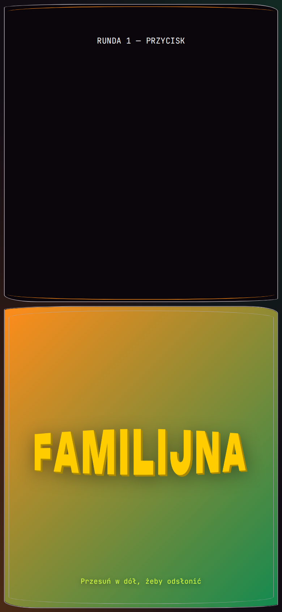

### Prowadzący — bridge — pl · phone

### Prowadzący — bridge — zasłona — pl · phone

### Wyświetlacz — logo gry na starcie (nazwy drużyn) — pl · 1600×900

### Wyświetlacz — pojedynek: pusta plansza i lampka drużyny — pl · 1600×900

### Wyświetlacz — przejęcie: trzy X drużyny B, duży X drużyny A — pl · 1600×900

### Wyświetlacz — rozgrywka: odsłonięte odpowiedzi, pula i jeden X — pl · 1600×900

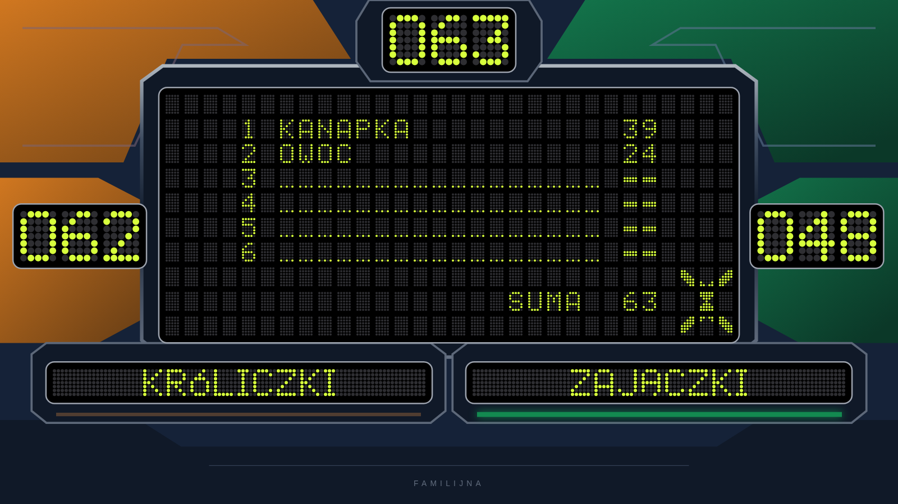

### Wyświetlacz — finał po graczu 1: odpowiedzi i suma — pl · 1600×900

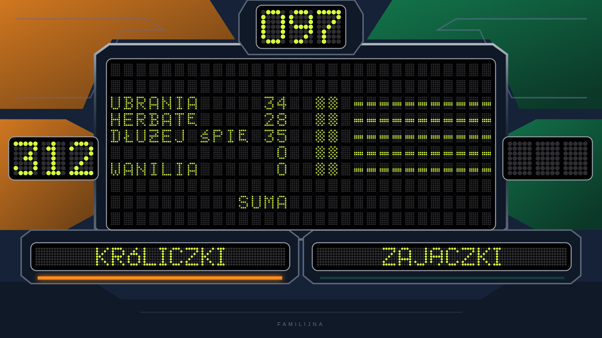

### Wyświetlacz — plansza finału: odpowiedzi gracza 1 i 2 — pl · 1600×900

### Wyświetlacz — koniec gry: wygrana kwota — pl · 1600×900

### Wyświetlacz — koniec gry bez finału: punkty zwycięzców — pl · 1600×900

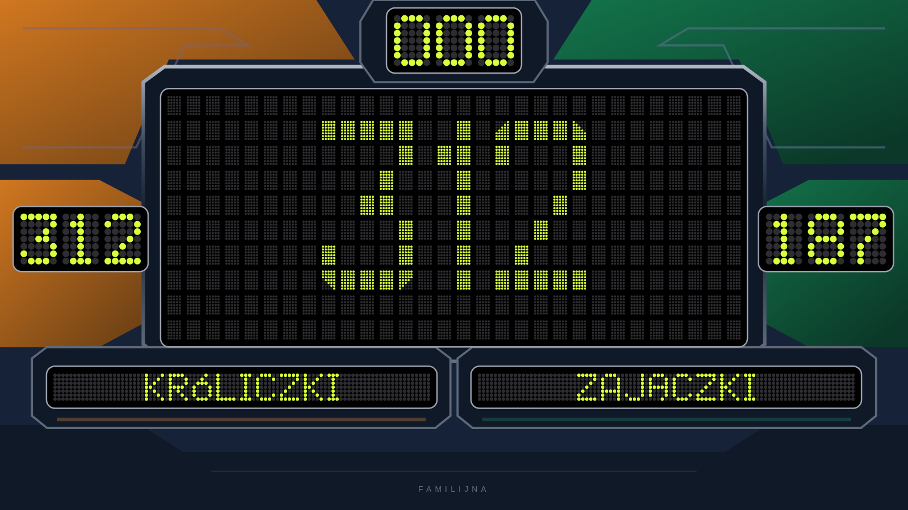

### Wyświetlacz — koniec gry: logo (remis) — pl · 1600×900

### Prowadzący — motyw wgrany (ramki z pliku) — pl · phone

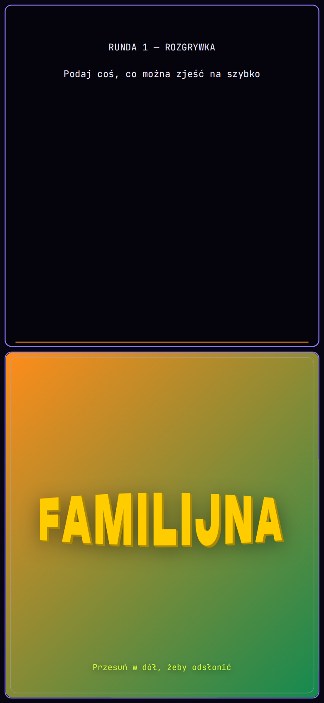
