# Mails — symulowane zrzuty aktualnego interfejsu

Zrzuty renderują bieżący HTML, CSS i JavaScript z `web/`. Lokalny podgląd
podstawia odpowiedzi API i przykładowe rekordy, więc niczego nie pobiera ani
nie zapisuje na koncie i nie wysyła maili. Rozmiary: komputer 1400 × 900,
telefon 390 × 844; dodatkowo aktywny widok telefonu poziomo 844 × 390.

W zwykłym centrum Mails na komputerze obie listy są pokazane równolegle jako
karty w jednej wspólnej karcie. Na telefonie zostaje dotychczasowy wybór listy
wypustkami i zakładkami; przy nazwie listy widać licznik, tak jak u Znajomych.
Licznik nie jest powielany przy desktopowych nagłówkach. Odstęp nagłówka od
listy zwiększono. Formularz wpisania adresu pozostaje osobnym, węższym widokiem.

Wybrane zakładki zapisują się jako `?tab=items` w tym samym URL-u; domyślna
„Subskrypcje” nie dodaje parametru. Zmiana używa `replaceState`, więc nie
tworzy osobnej ścieżki ani pozycji w historii Wstecz.

W każdym stanie sprawdzono brak błędów JavaScript i poziomego przepełnienia.

| Stan | Telefon | Komputer |
|---|---|---|
| Wpisywanie adresu | 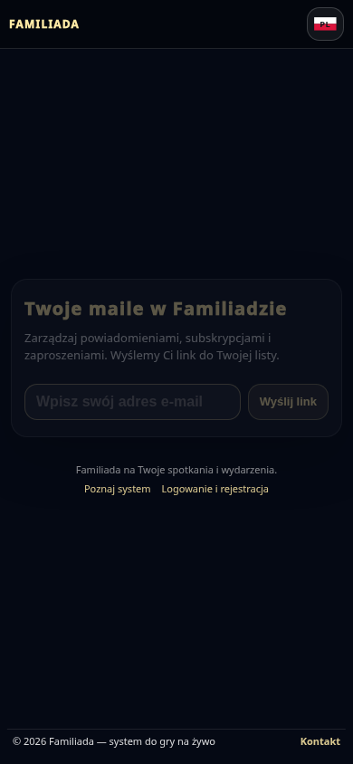 | 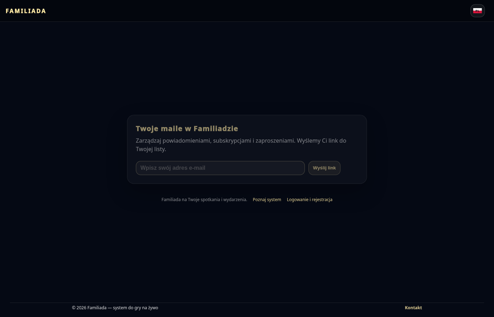 |
| Link wysłany | 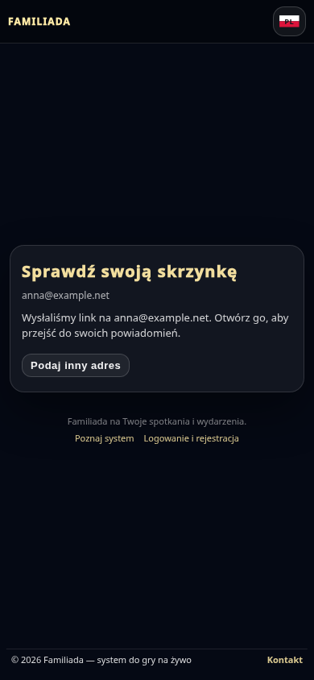 | 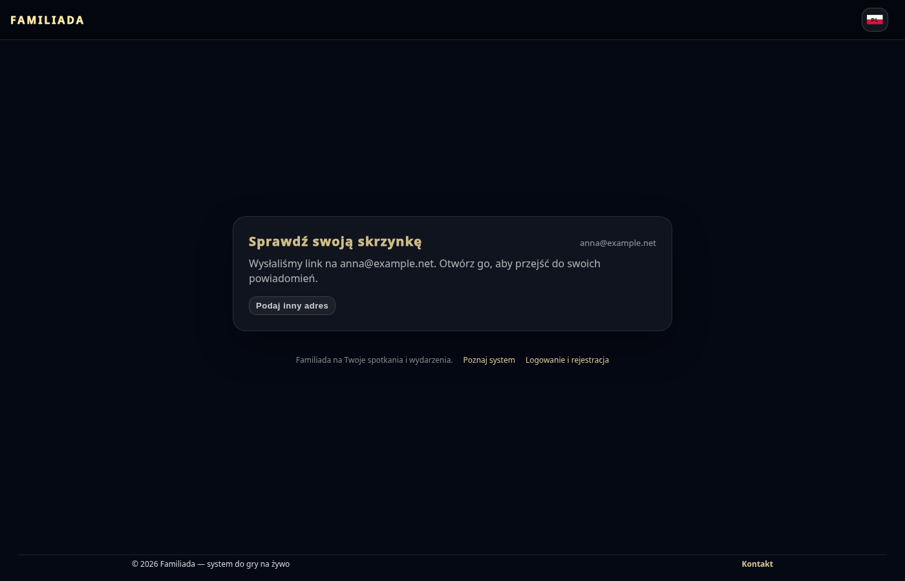 |
| Potwierdzenie adresu | 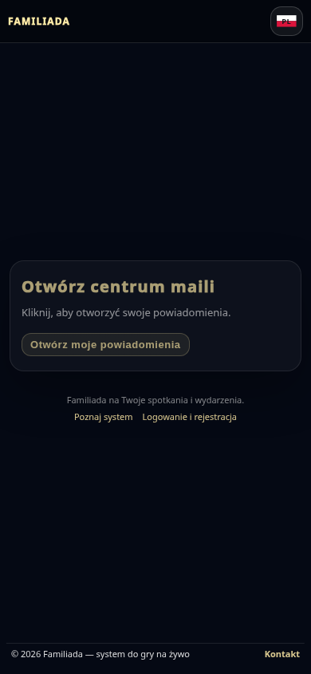 | 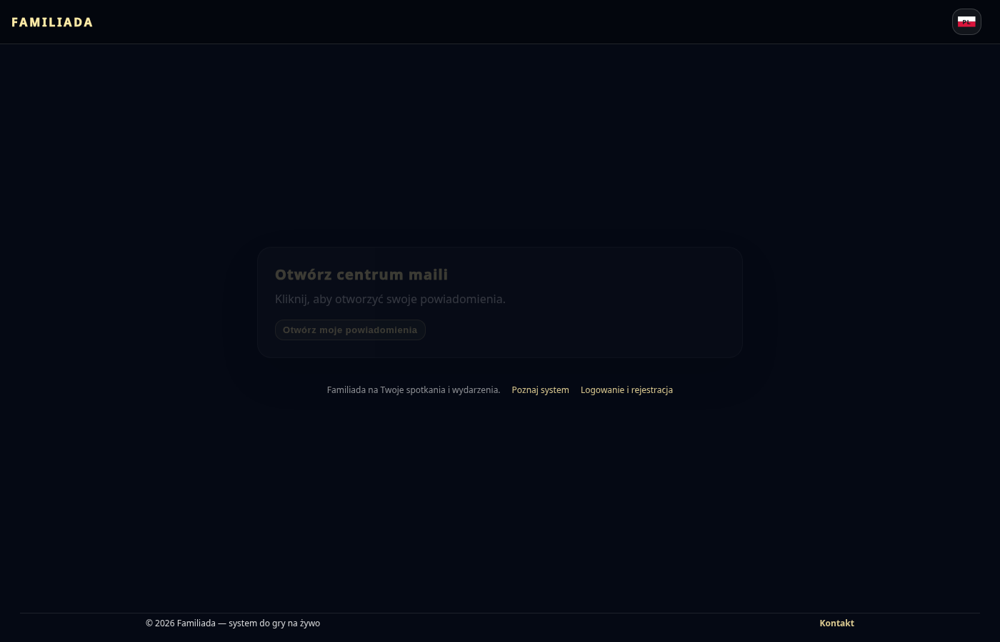 |
| Aktywne centrum | 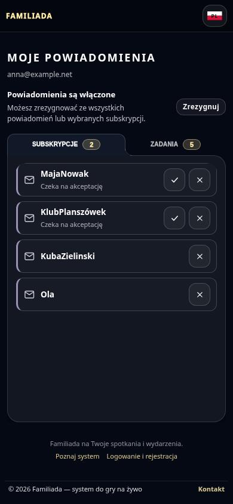 | 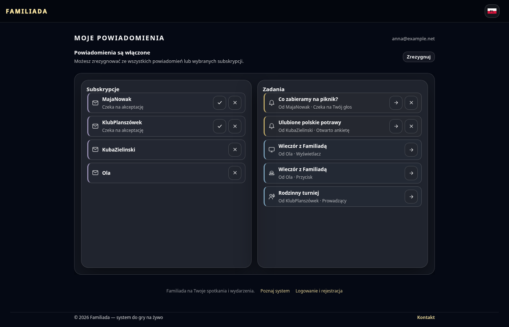 |
| Zadania: ankiety i urządzenia | 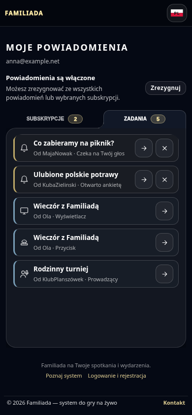 | 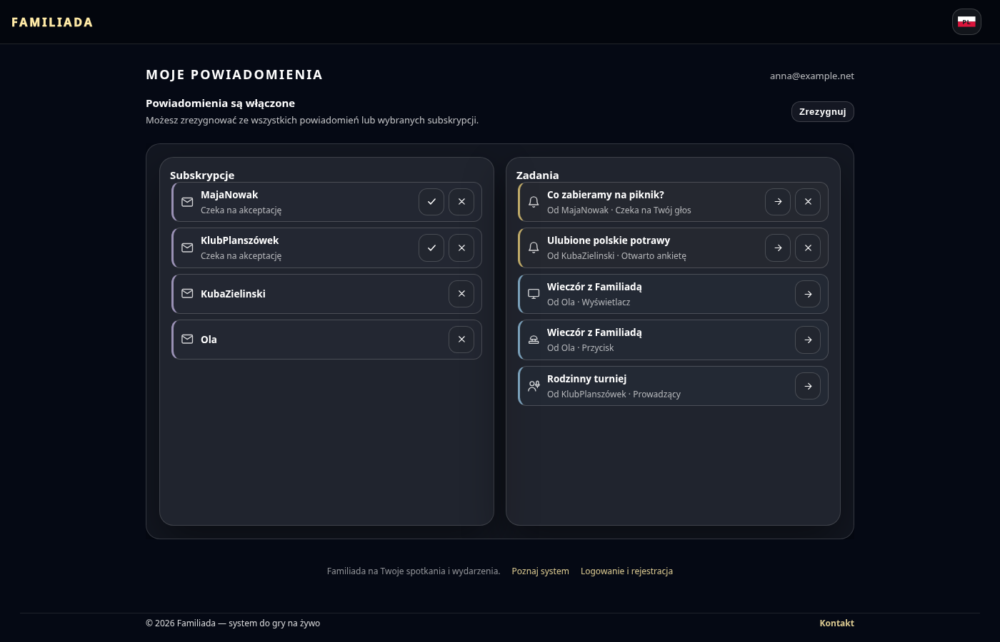 |
| Powiadomienia wyłączone | 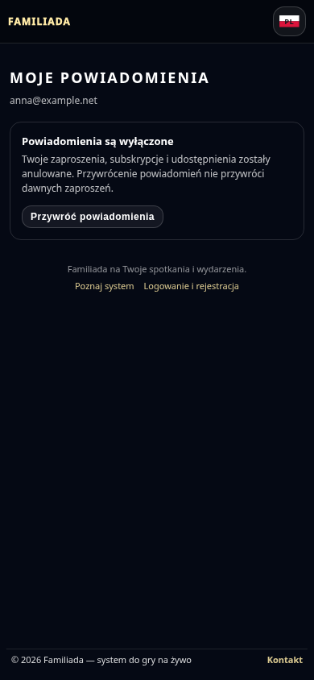 | 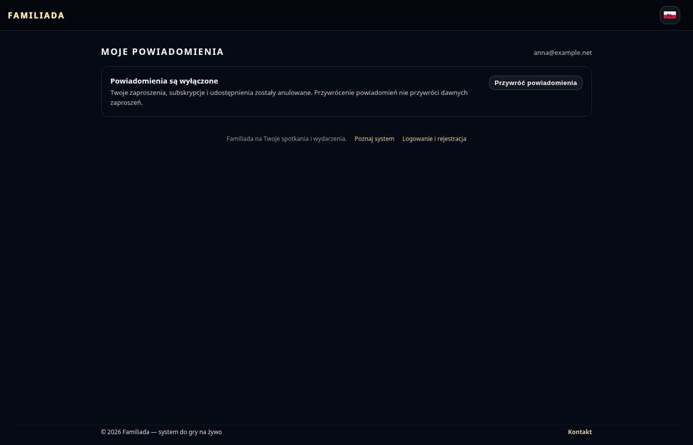 |
| Nieaktualny link | 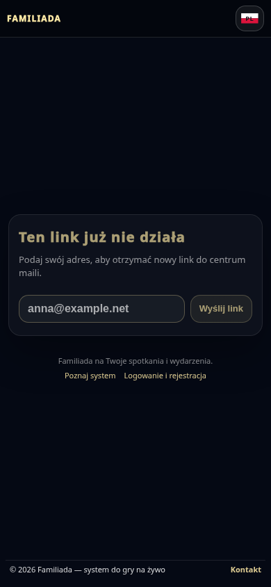 | 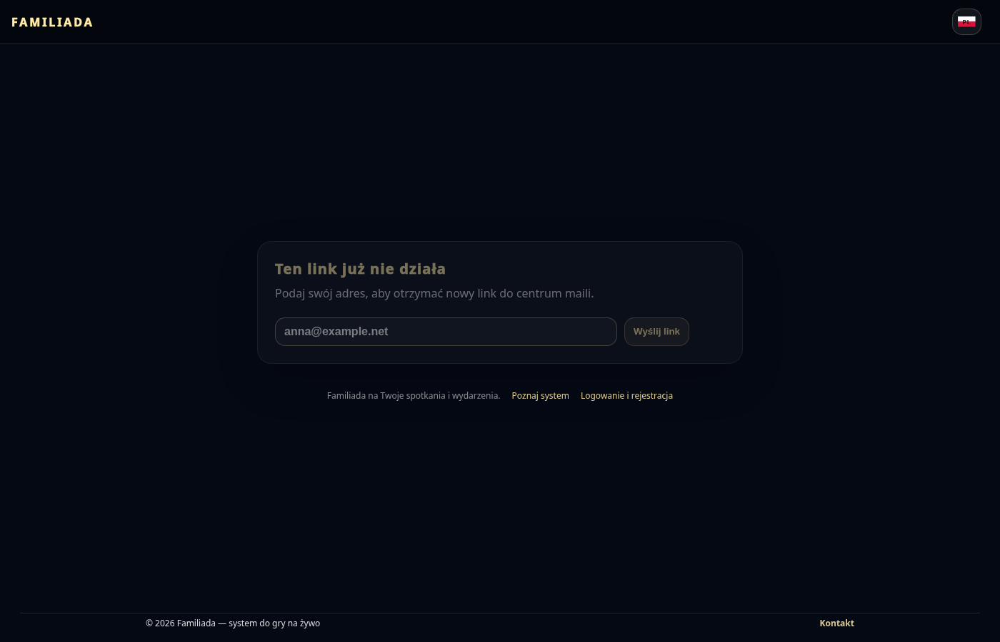 |
| Adres powiązany z kontem | 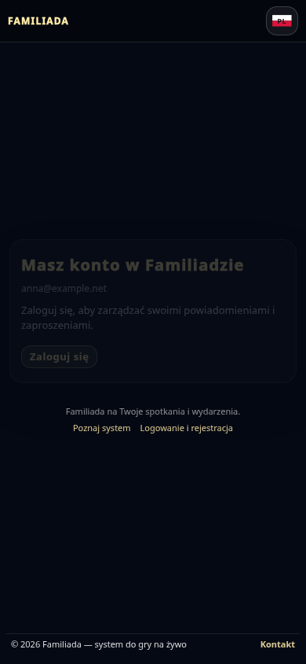 | 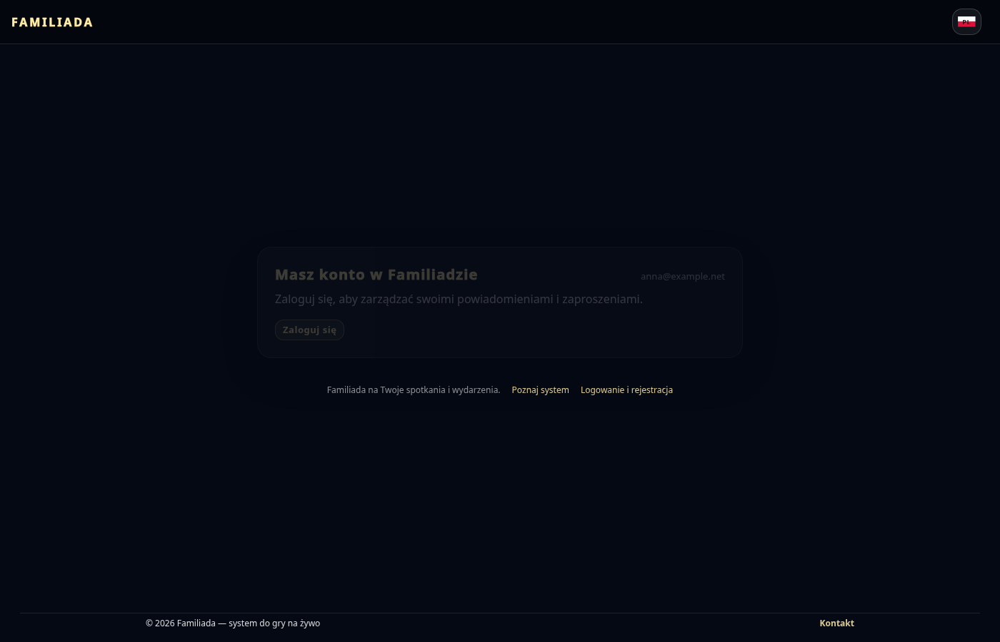 |
| Puste centrum | 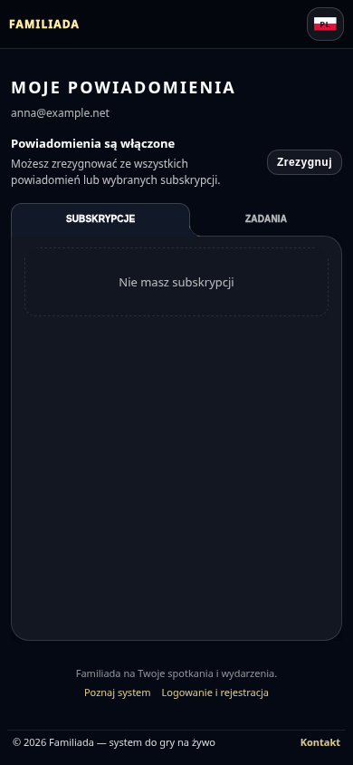 | 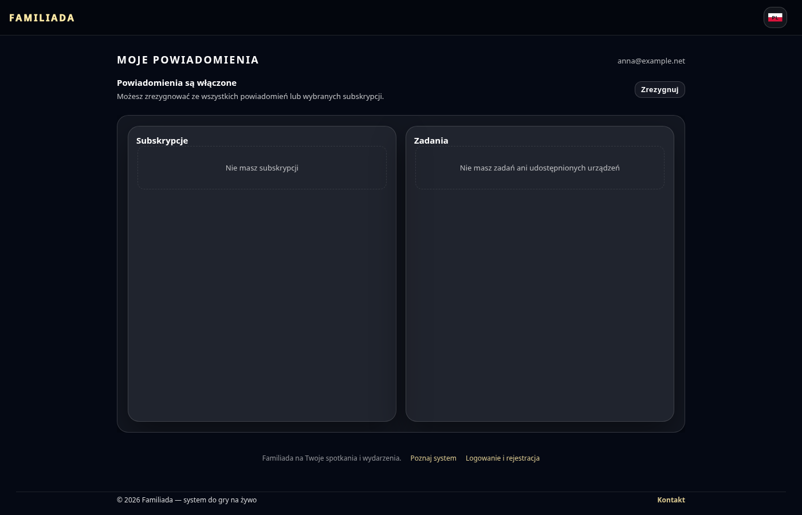 |

## Pozostałe ujęcia

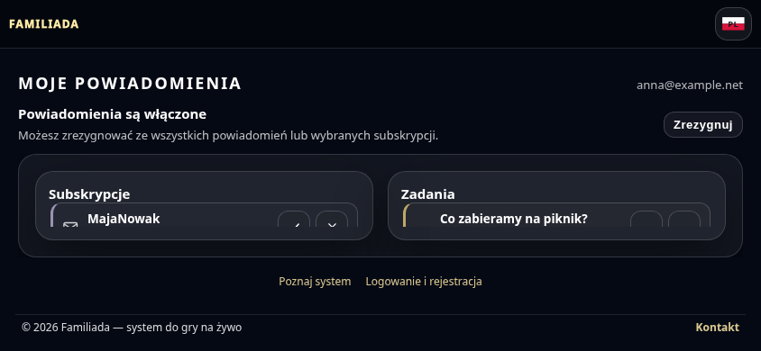

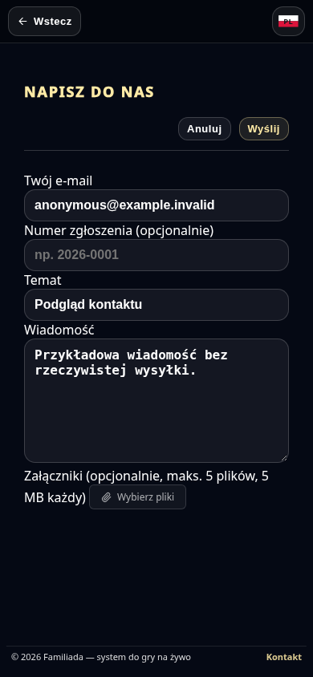

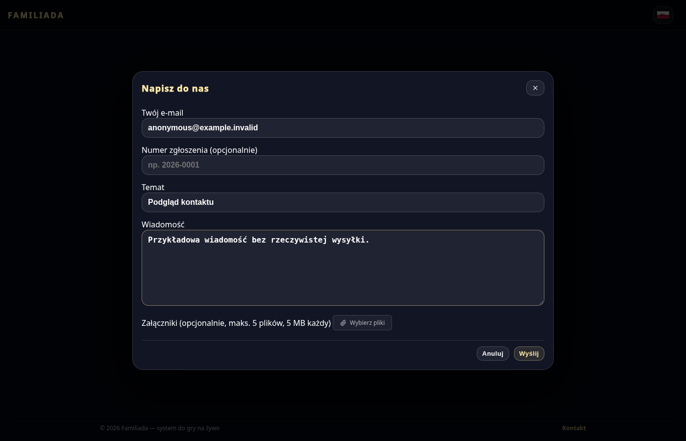
