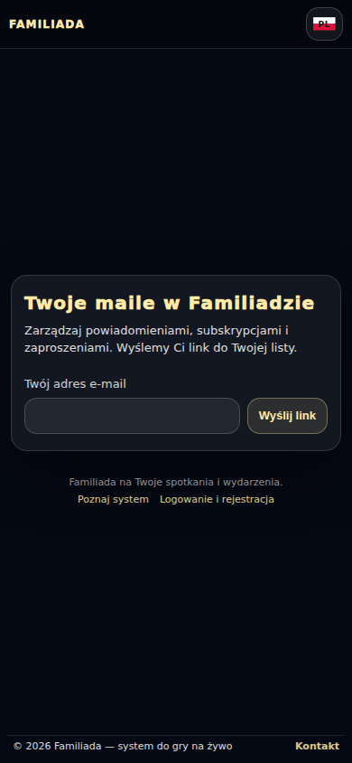
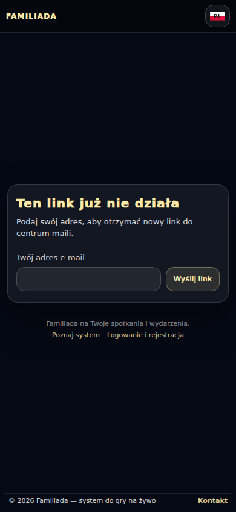
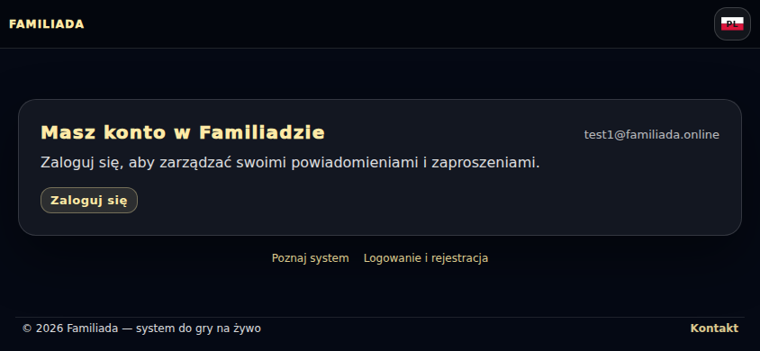
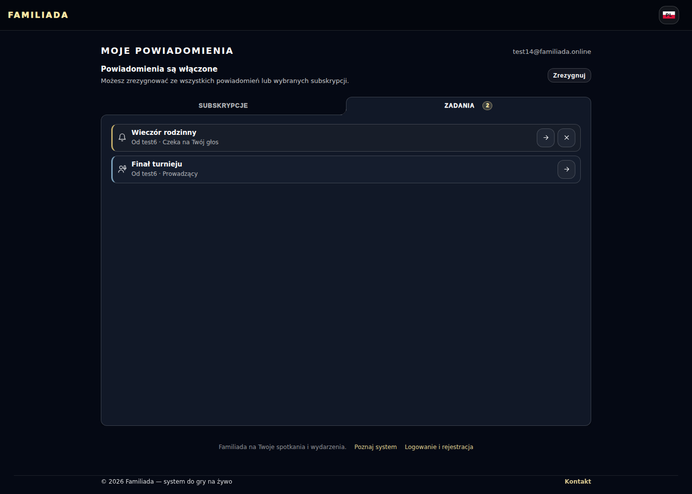
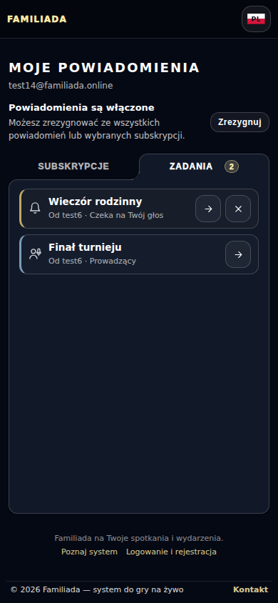
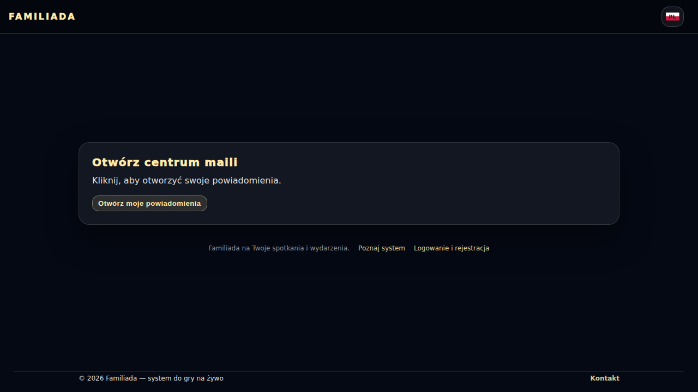
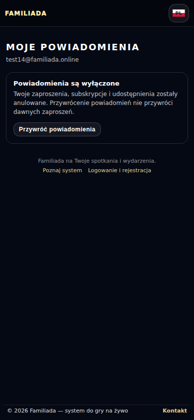
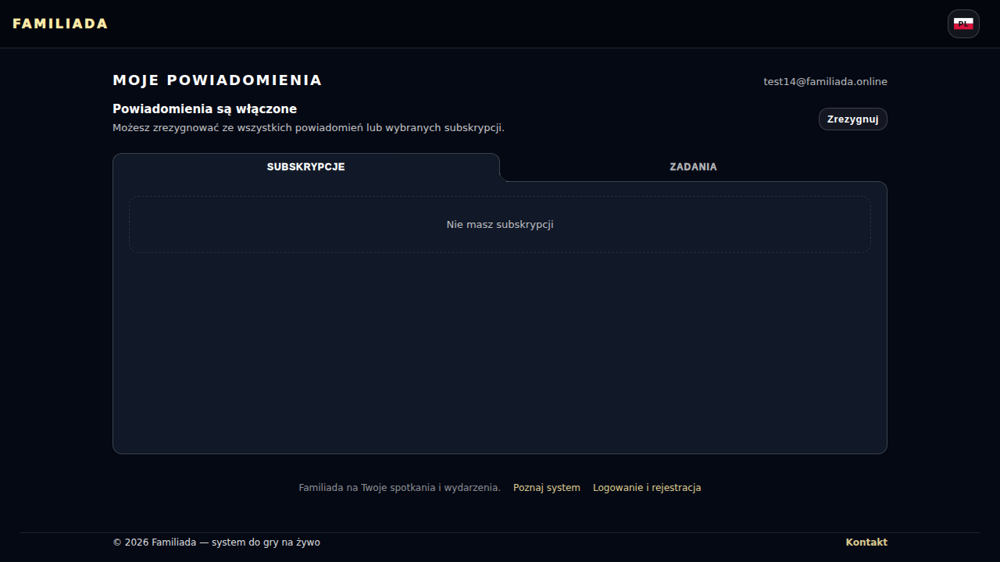

# Centrum maili — zrzuty z testu produkcji

Przebieg [38308851386](https://github.com/Andrish97/familiada/actions/runs/38308851386), kod `591300e59c6d42c2e6080353ea42a13db07cf2a1`.

Rzeczywiste maile i dane kont testowych. Zrzuty po wykonaniu zmian.

## entry-390

## expired-390

## registered-landscape

## active-1400

## active-390

## confirmation

## disabled-390

## restored-empty

