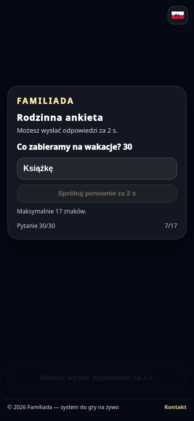
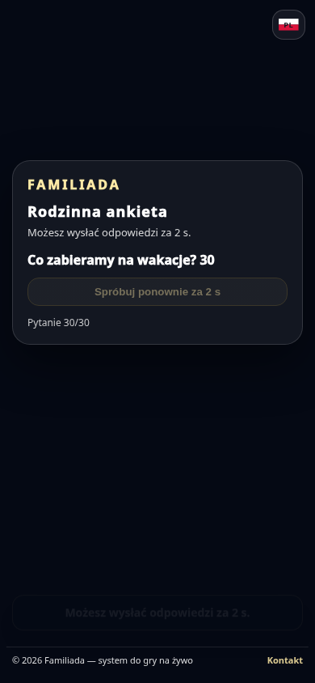
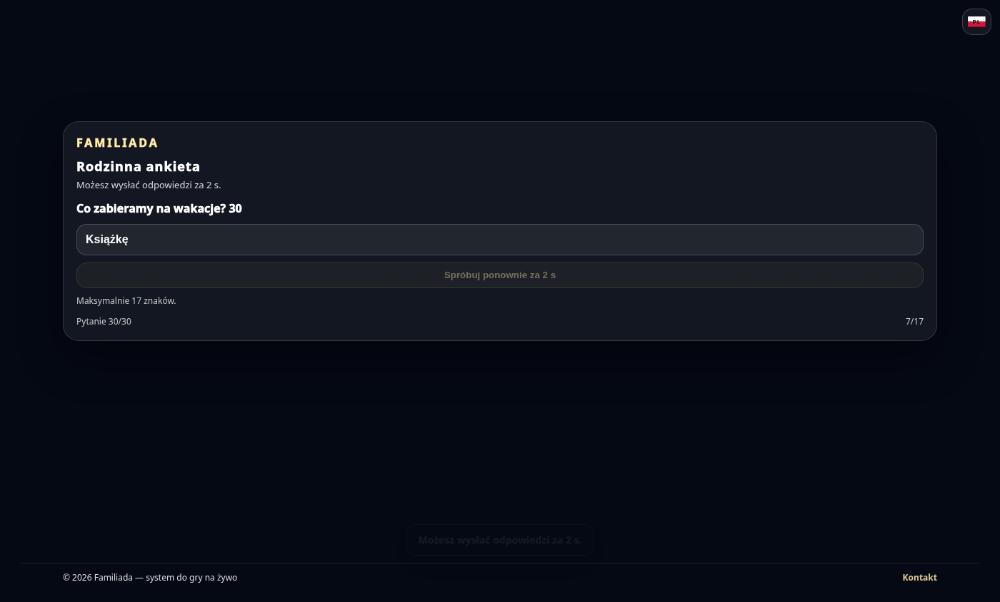
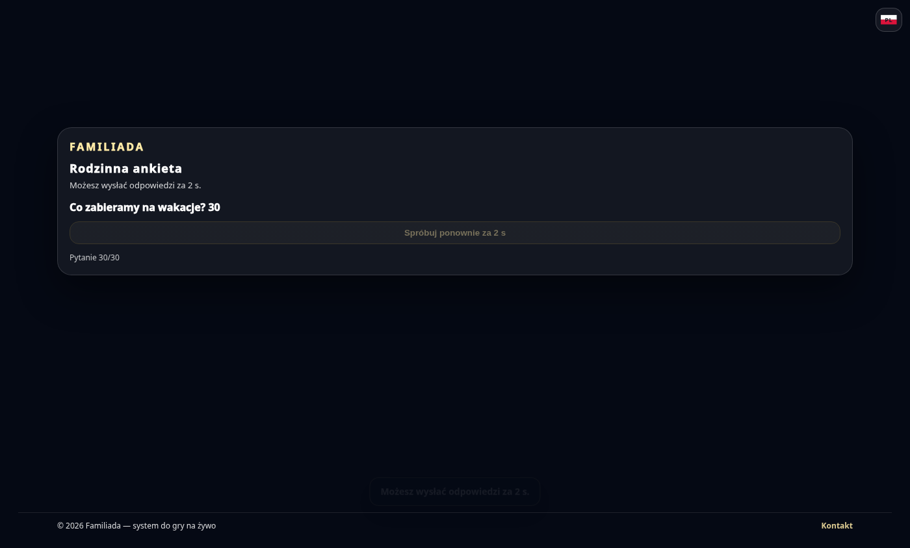

# Anonimowe głosowanie — odliczanie i zachowanie odpowiedzi

Podgląd wykonanego interfejsu z przykładową rodzinną ankietą (30 pytań).
Lokalna przeglądarka Chromium; odpowiedź serwera z odliczaniem jest symulowana.
Te zrzuty pokazują wygląd, nie stan wdrożenia ani wynik testu produkcyjnego.

## Tekst — telefon

## Punkty — telefon

## Tekst — komputer

## Punkty — komputer

