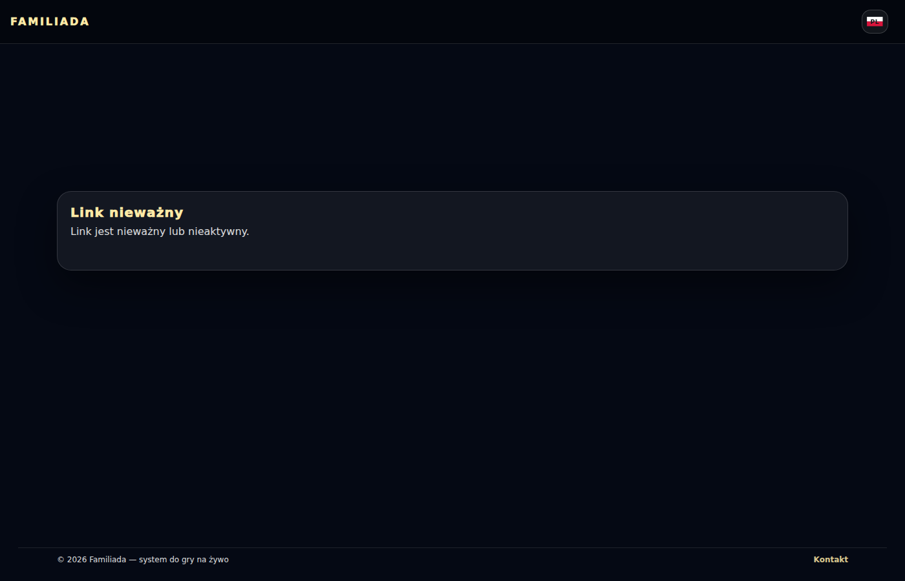
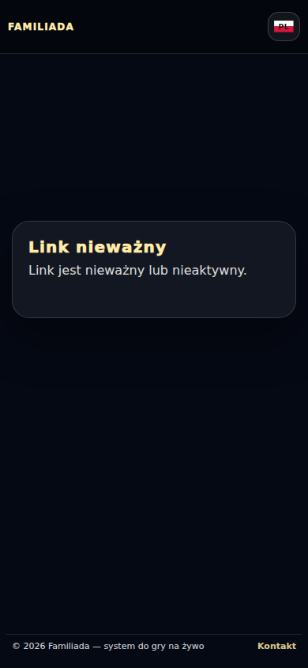
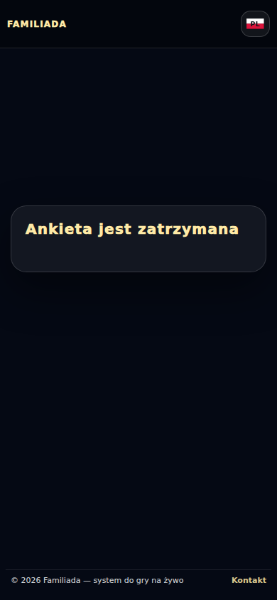
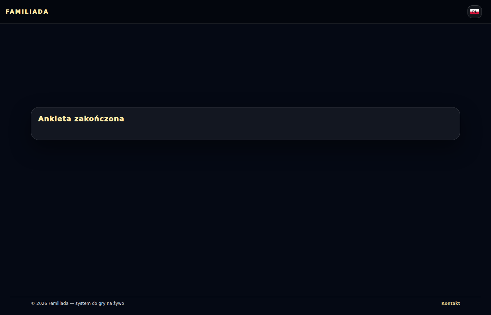
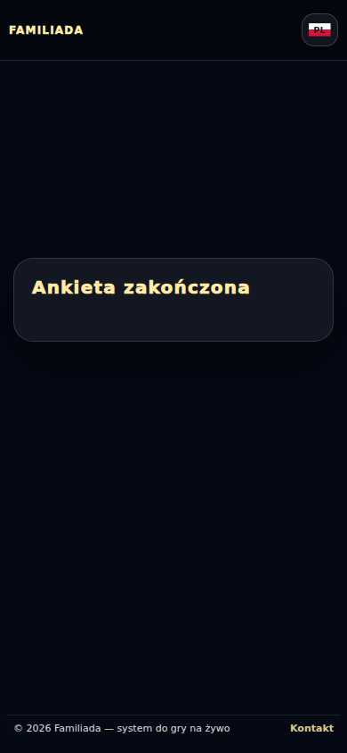
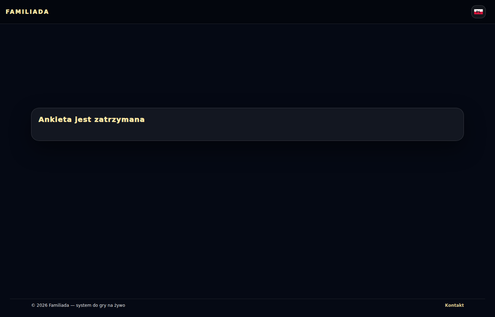

# Anonimowe ankiety — głosowanie i stany linków

Przebieg [38315943894](https://github.com/Andrish97/familiada/actions/runs/38315943894), kod `65cc43758a3007b9b7885f9d67f98708cfa16444`.

Rzeczywista baza i ankiety kont testowych. Odliczanie z serwera, zachowane odpowiedzi; telefon i komputer.

## go-invalid-1400

## go-invalid-390

## go-poll_points-ended-1400

## go-poll_points-ended-390

## go-poll_points-stopped-1400

## go-poll_points-stopped-390

## go-poll_text-ended-1400

## go-poll_text-ended-390

## go-poll_text-stopped-1400

## go-poll_text-stopped-390

