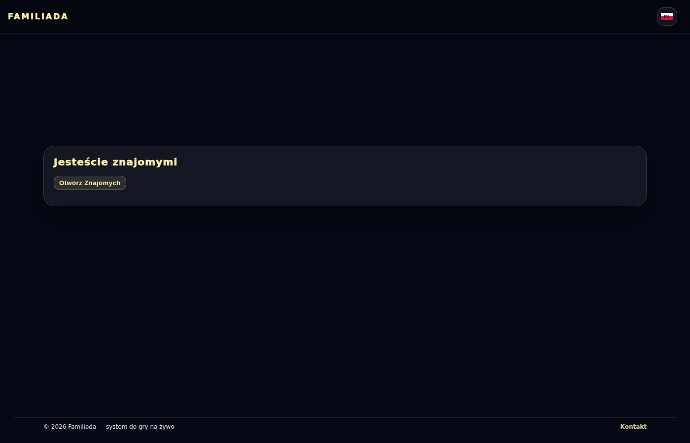
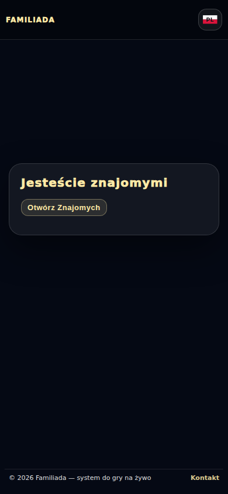
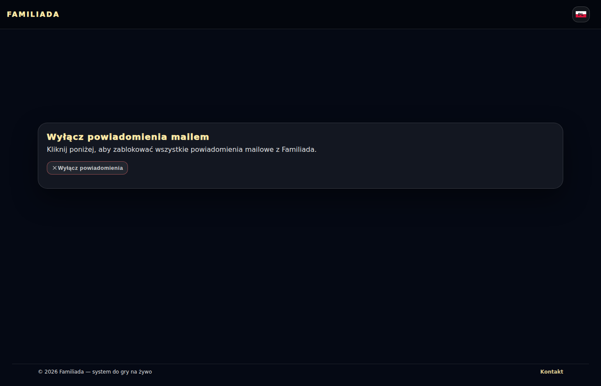
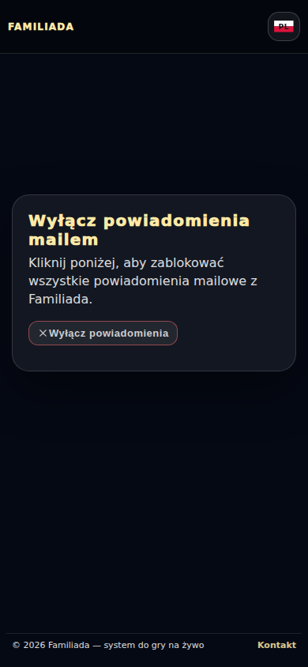

# Anonimowe ankiety — głosowanie i stany linków

Przebieg [38321062827](https://github.com/Andrish97/familiada/actions/runs/38321062827), kod `333f212e0793b494920102ad31fbbfe214c1f595`.

Macierz komunikatów: przykładowe odpowiedzi resolverów, rzeczywiste logowanie. Te zrzuty sprawdzają interfejs, nie dostarczanie maili ani zmiany w bazie. Telefon i komputer.

## go-matrix-base-cancelled-1400

## go-matrix-base-cancelled-390

## go-matrix-base-declined-1400

## go-matrix-base-declined-390

## go-matrix-base-done-1400

## go-matrix-base-done-390

## go-matrix-canonical-account-1400

## go-matrix-canonical-account-390

## go-matrix-friends-active-1400

## go-matrix-friends-active-390

## go-matrix-guest-subscription-1400

## go-matrix-guest-subscription-390

## go-matrix-historical-friend-1400

## go-matrix-historical-friend-390

## go-matrix-legacy-notifications-1400

## go-matrix-legacy-notifications-390

## go-matrix-network-retry-1400

## go-matrix-network-retry-390

## go-matrix-unavailable-1400

## go-matrix-unavailable-390

## go-matrix-wrong-account-1400

## go-matrix-wrong-account-390

