# Anonimowe ankiety — głosowanie i stany linków

Przebieg [38320834879](https://github.com/Andrish97/familiada/actions/runs/38320834879), kod `012823a8d63775cf274dc41a384b6ba8d5ca8be9`.

Macierz komunikatów: przykładowe odpowiedzi resolverów, rzeczywiste logowanie. Te zrzuty sprawdzają interfejs, nie dostarczanie maili ani zmiany w bazie. Telefon i komputer.

## go-matrix-base-cancelled-1400

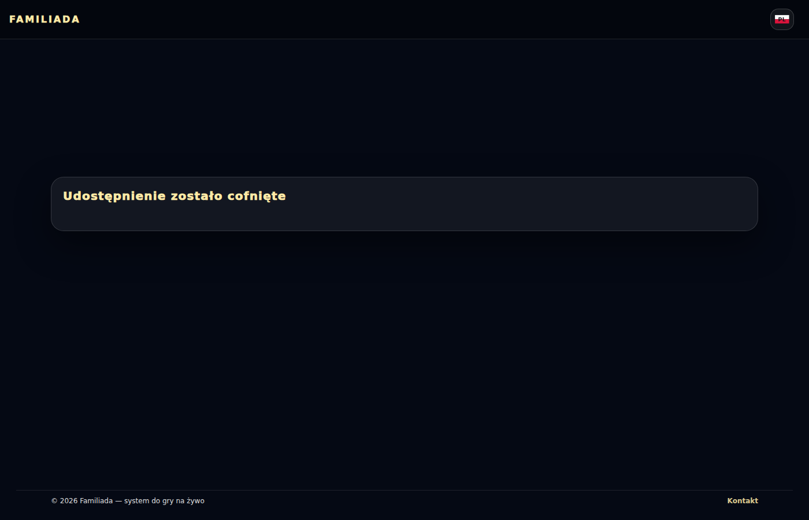

## go-matrix-base-cancelled-390

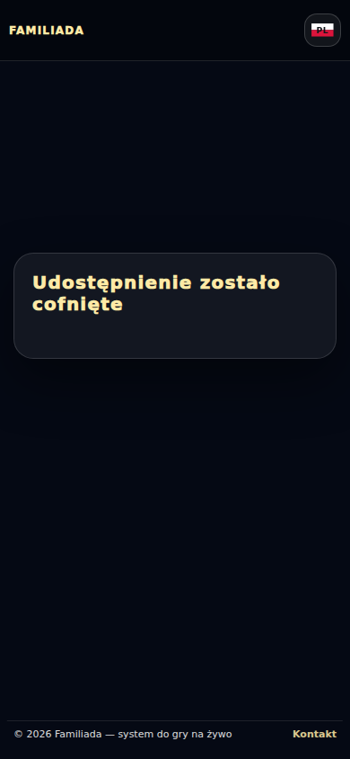

## go-matrix-base-declined-1400

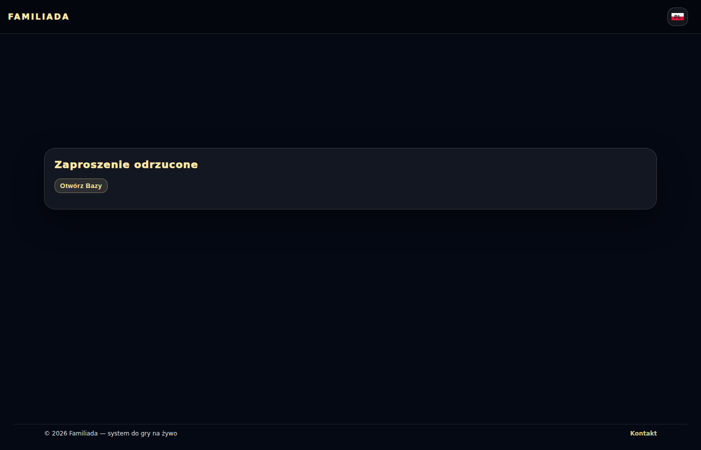

## go-matrix-base-declined-390

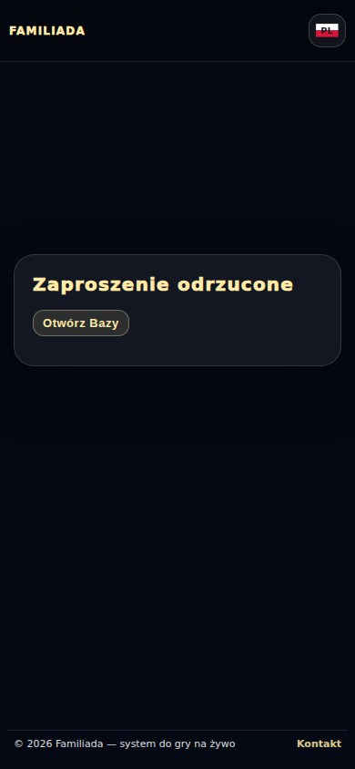

## go-matrix-base-done-1400

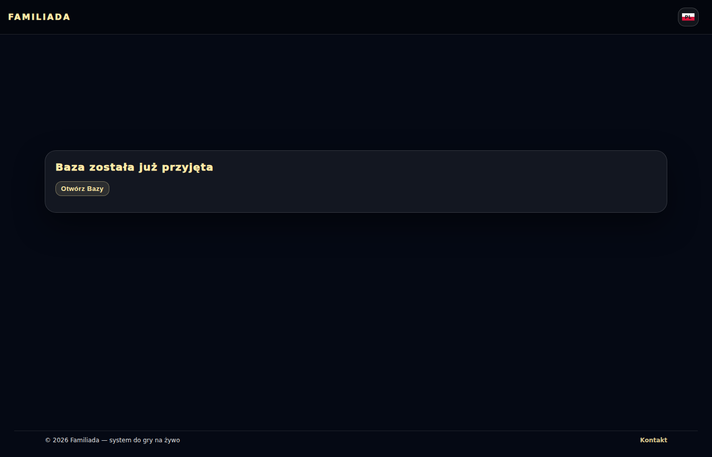

## go-matrix-base-done-390

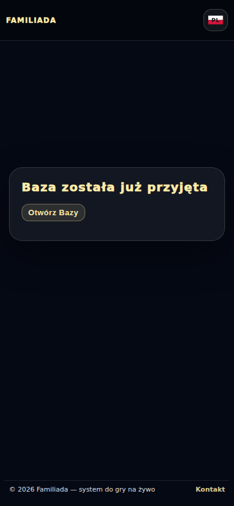

## go-matrix-canonical-account-1400

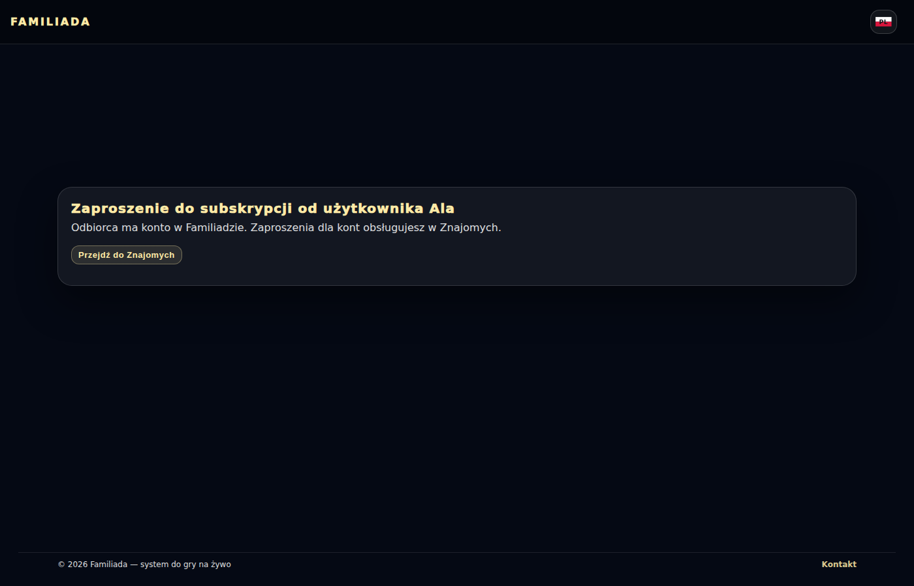

## go-matrix-canonical-account-390

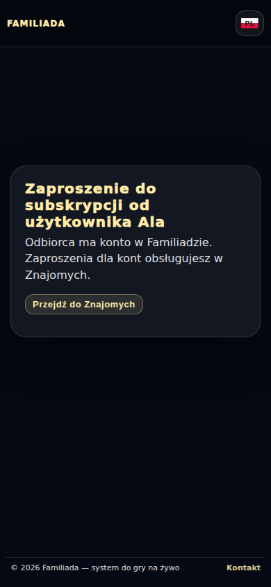

## go-matrix-guest-subscription-1400

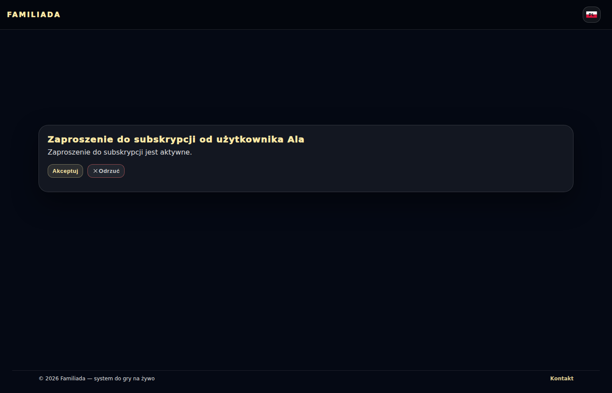

## go-matrix-guest-subscription-390

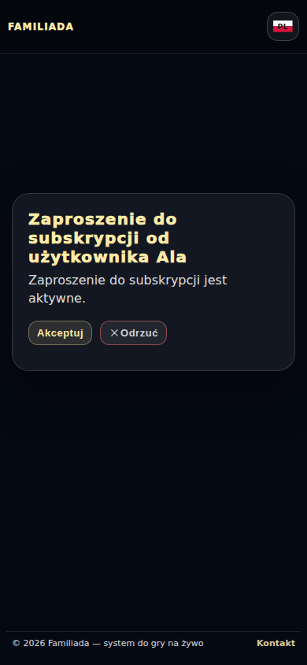

## go-matrix-historical-friend-1400

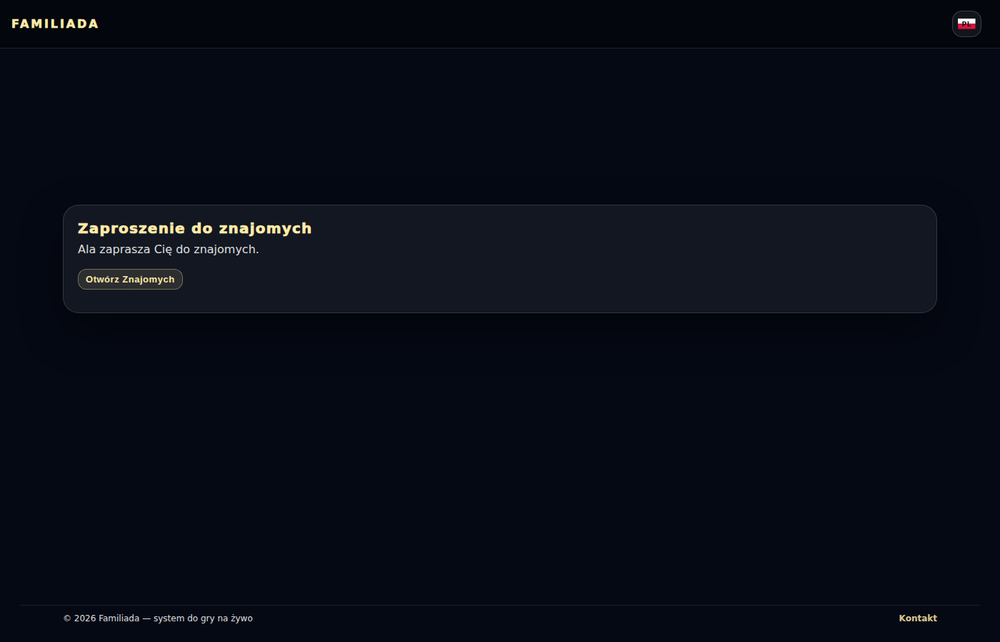

## go-matrix-historical-friend-390

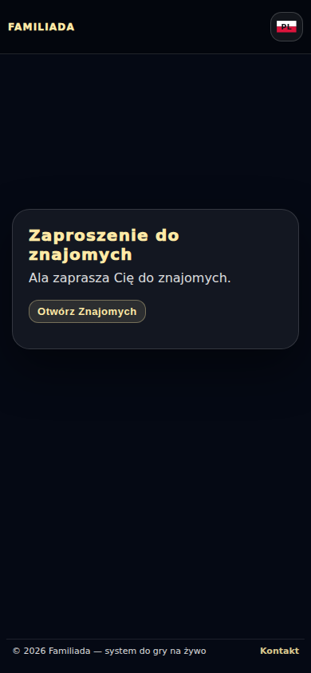

## go-matrix-network-retry-1400

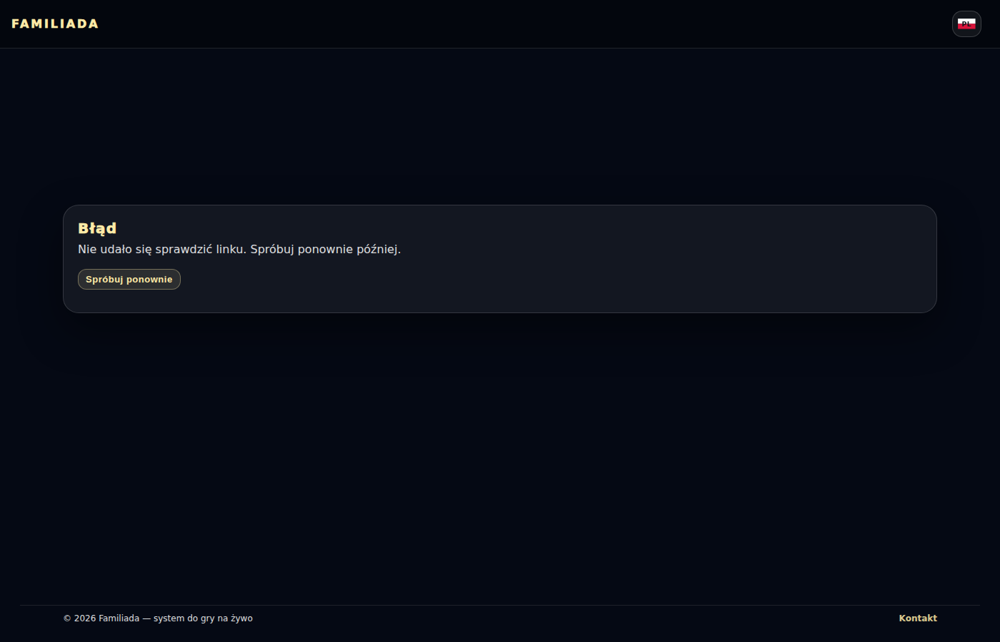

## go-matrix-network-retry-390

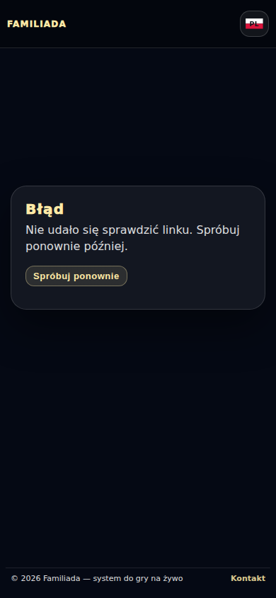

## go-matrix-unavailable-1400

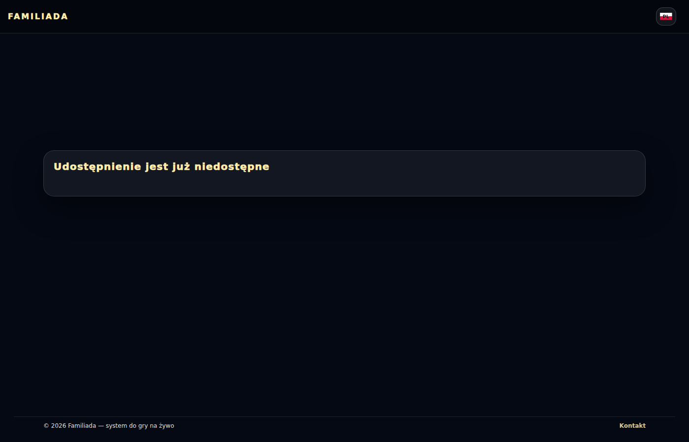

## go-matrix-unavailable-390

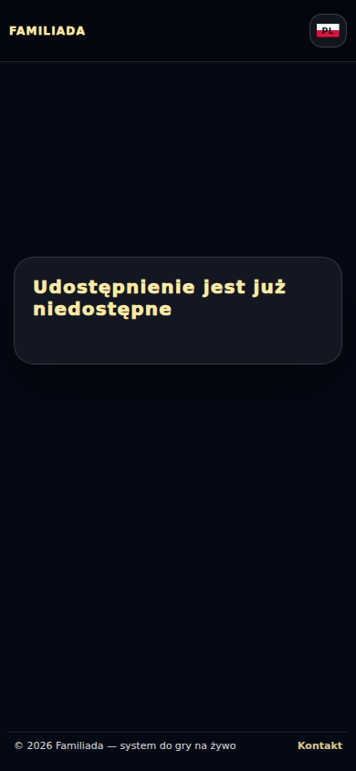

## go-matrix-wrong-account-1400

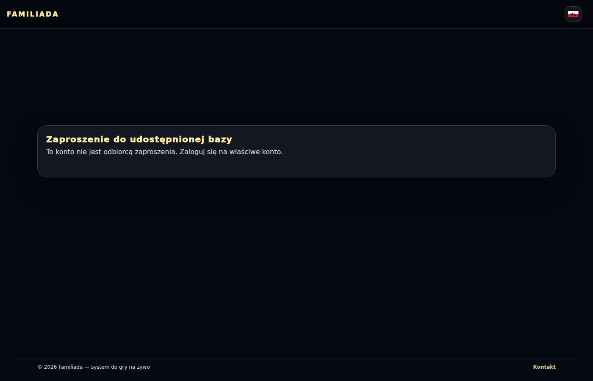

## go-matrix-wrong-account-390

