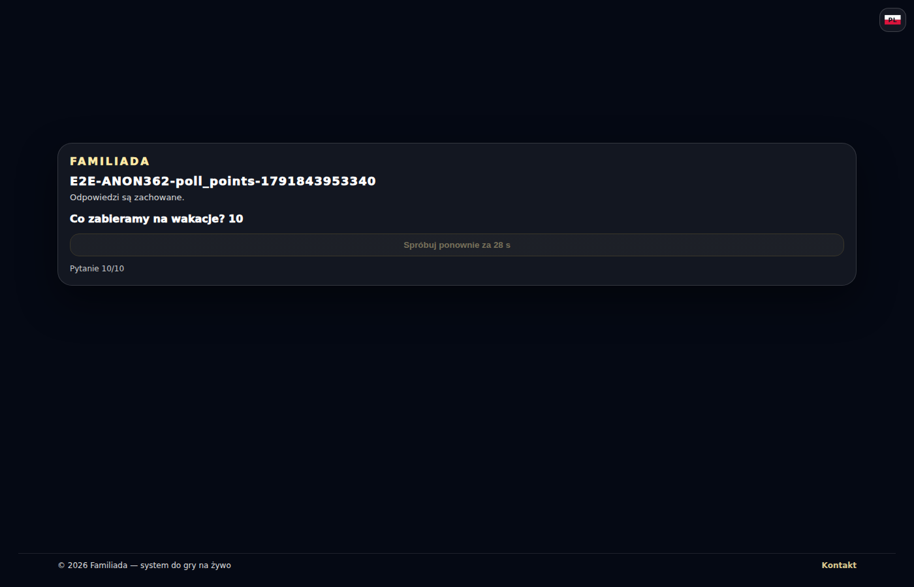
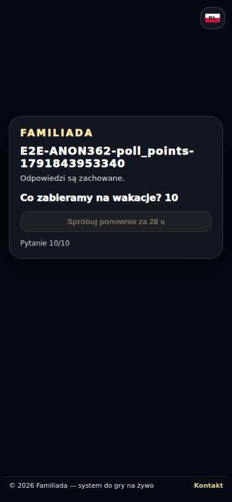
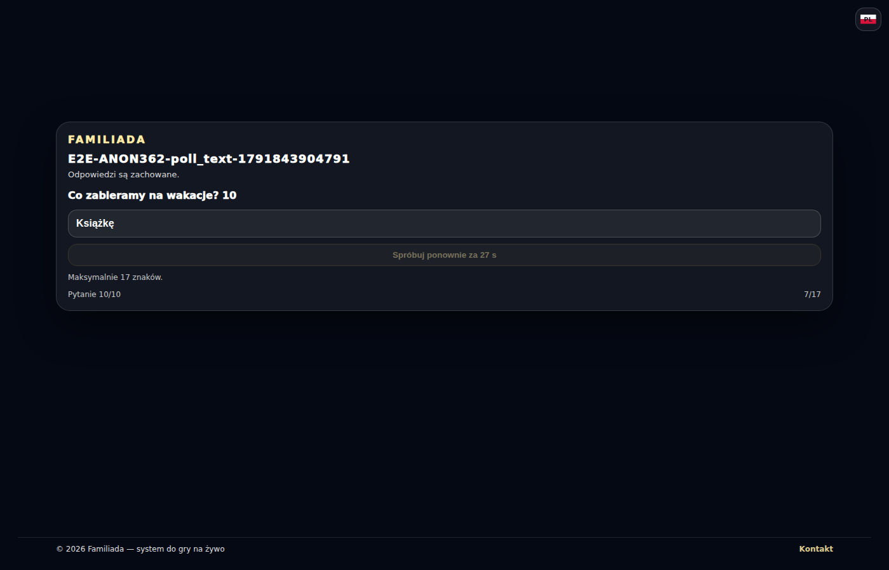
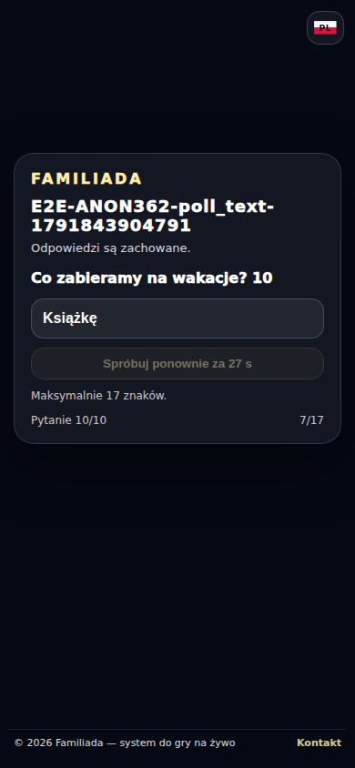

# Anonimowe ankiety — głosowanie i stany linków

Przebieg [38316440463](https://github.com/Andrish97/familiada/actions/runs/38316440463), kod `292296105ad2f86e5d1badc83ff4e24d2f166aa1`.

Rzeczywista baza i ankiety kont testowych. Zrzuty po wykonaniu zmian; telefon i komputer.

## poll_points-cooldown-1400

## poll_points-cooldown-390

## poll_text-cooldown-1400

## poll_text-cooldown-390

