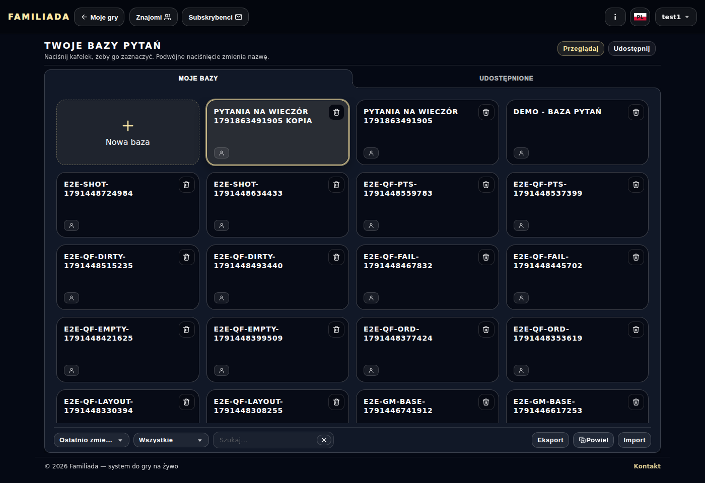
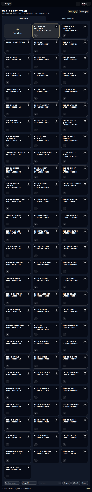
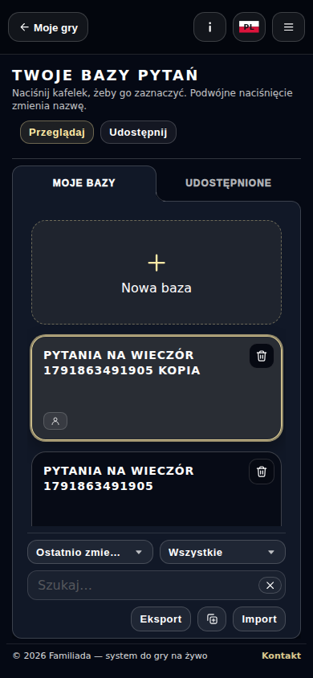
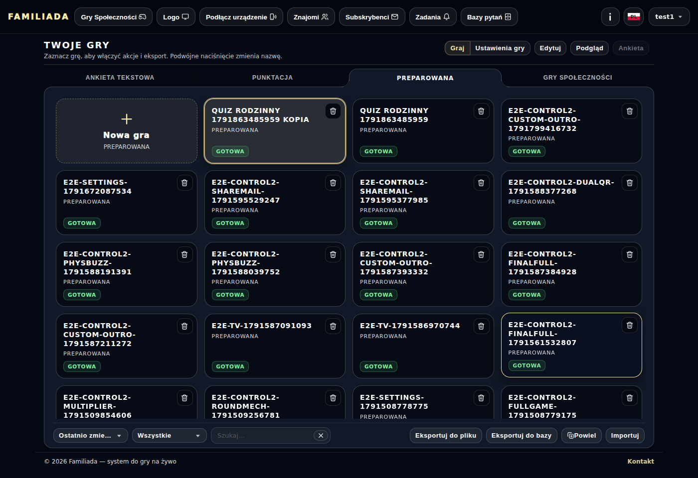
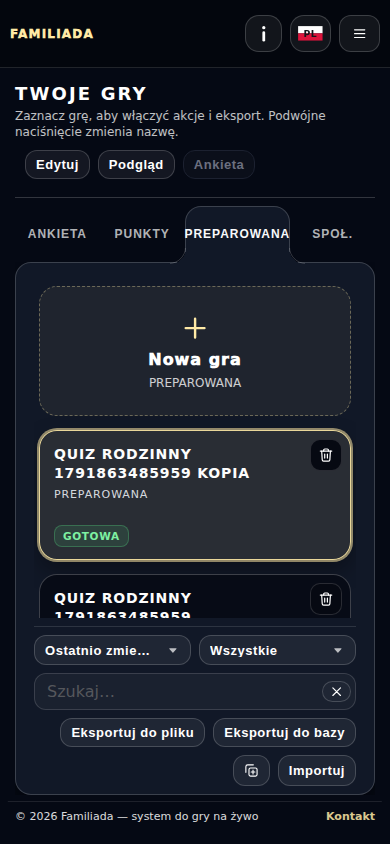
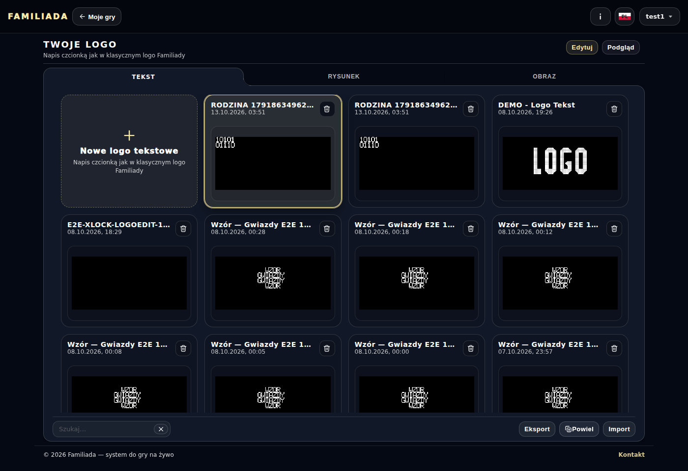
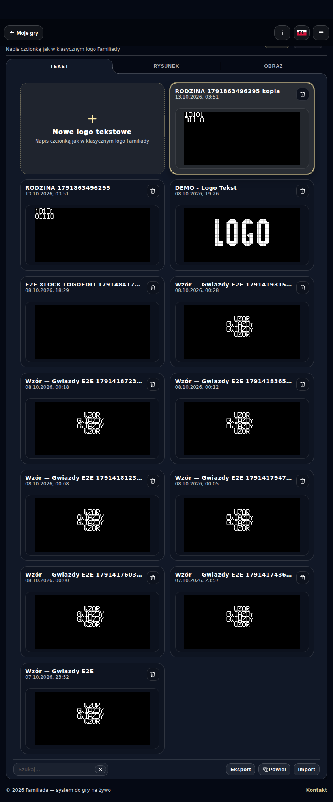
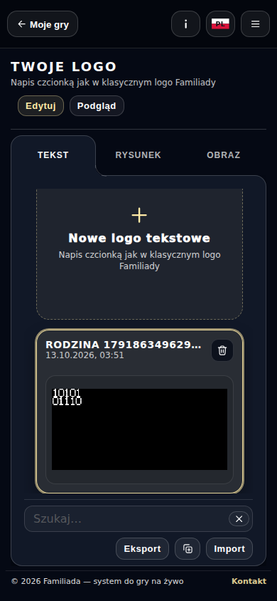

# Powiel — Gry, Bazy i Logo

Przebieg [38343598152](https://github.com/Andrish97/familiada/actions/runs/38343598152), kod `665f80d6dbe555ad8c70eefd808ffc2baf887446`.

Rzeczywiste kopie na koncie testowym. Dopisek w nazwie; przycisk przy imporcie/eksporcie. Telefon390, komputer1400 i telefon w poziomie844×390.

## base-desktop

## base-landscape

## base-mobile

## game-desktop

## game-landscape

## game-mobile

## logo-desktop

## logo-landscape

## logo-mobile

