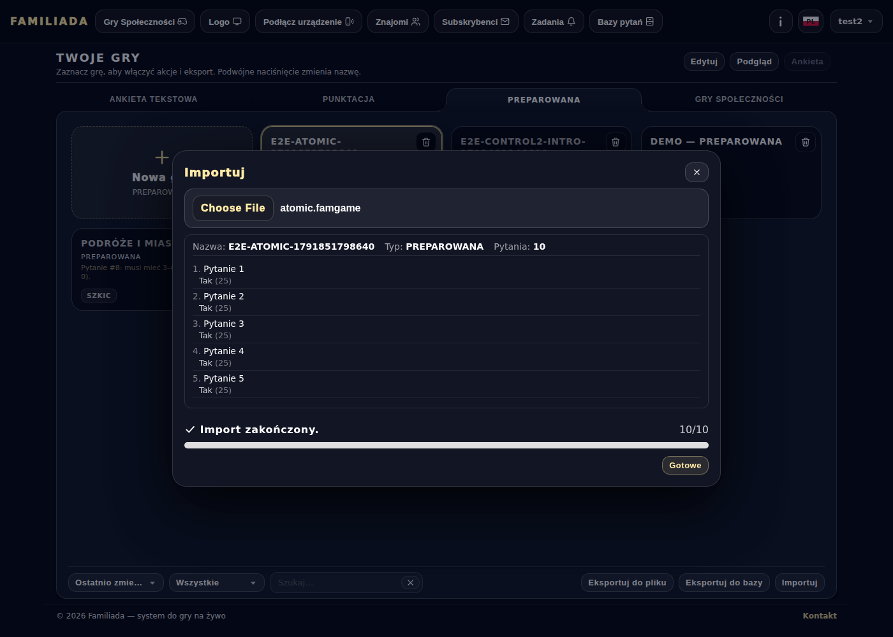
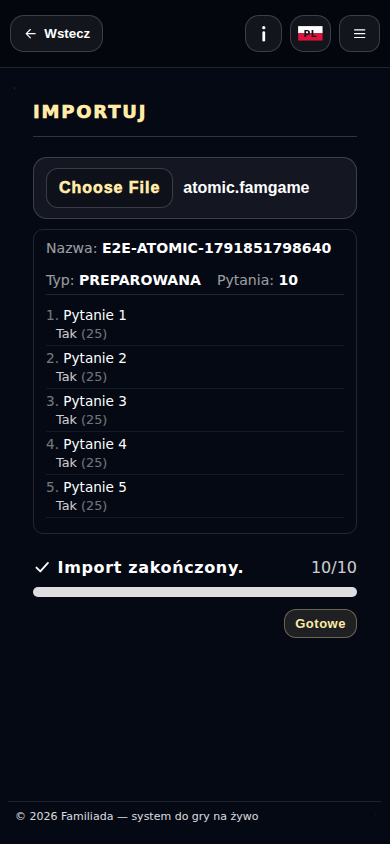

# Import gry — zakończenie

Przebieg [38328021470](https://github.com/Andrish97/familiada/actions/runs/38328021470), kod `14d12d6a33e84de5058fd6d1edded4cafd083694`.

Rzeczywisty import pliku na koncie testowym. Okno po zapisaniu gry, przed kliknięciem Gotowe. Telefon390 i komputer1400.

## success-desktop

## success-mobile

