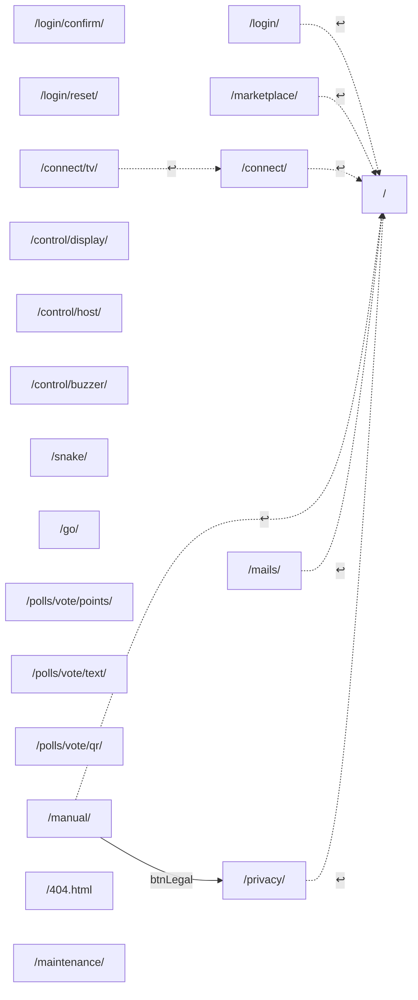
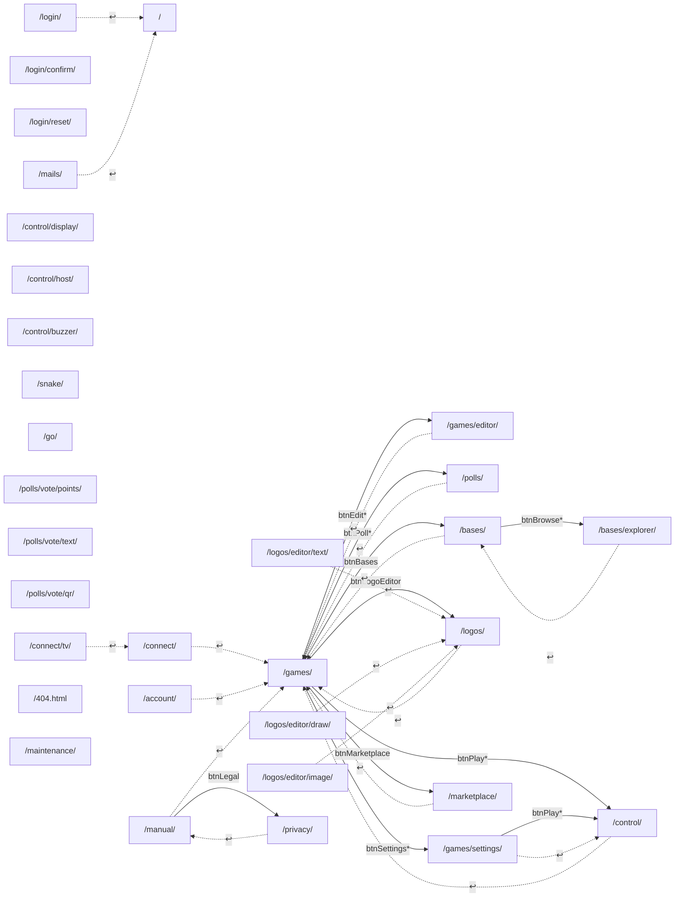
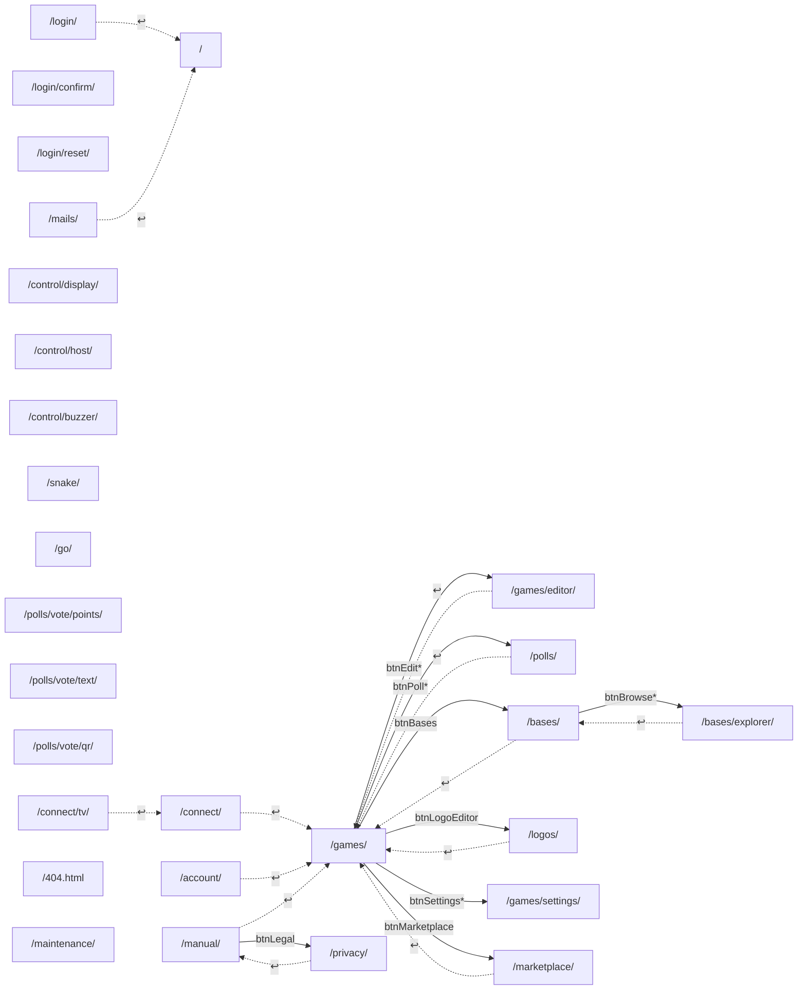
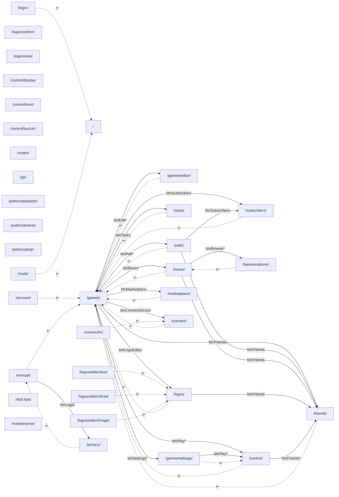
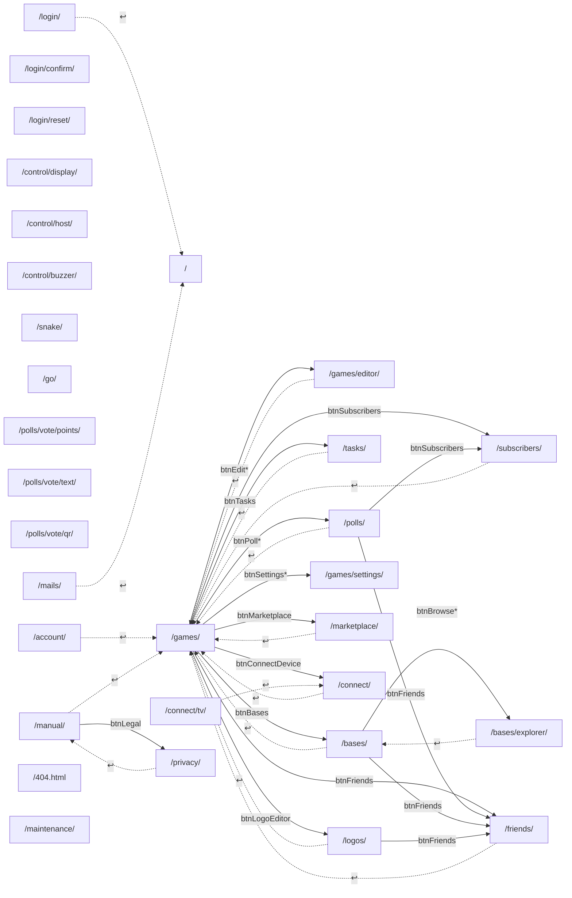

# Nawigacja — mapy przycisków (wygenerowane)

Sześć diagramów (rola × urządzenie) z `PAGES` w `web/shared/js/core/nav-map.js`.
Plik generuje `node scripts/nav-maps.mjs`; test `tests/unit/navButtons.test.js`
pilnuje zgodności. Decyzje dotyczące nawigacji są w prywatnym repo
`familijna-server` (`familijna-server/docs/nawigacja-mapa-plan.md`).

<!-- nav-maps:start -->

<!-- WYGENEROWANE z PAGES przez scripts/nav-maps.mjs — nie edytuj ręcznie. -->

Strzałka ciągła: przycisk z `PAGES[...].buttons` (nazwa = id elementu;
`*` — przycisk z własnym sprawdzeniem przed przejściem). Strzałka kreskowana:
↩ „Wstecz” bez `?ret=` (rodzic z mapy). `?` (instrukcja) prowadzi z każdej
strony z topbarem i nie jest tu rysowane. Przejścia z elementów list
(kafelki gier, baz, logo) nie są przyciskami mapy.
Linia bez strzałki: widoczny, zablokowany przycisk; podpis wskazuje zależność z mapy.

#### Diagram A1 — Niezalogowany, komputer

#### Diagram A2 — Niezalogowany, telefon

#### Diagram B1 — Gość, komputer

#### Diagram B2 — Gość, telefon

#### Diagram C1 — Konto, komputer

#### Diagram C2 — Konto, telefon

<!-- nav-maps:end -->
