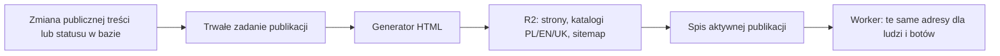
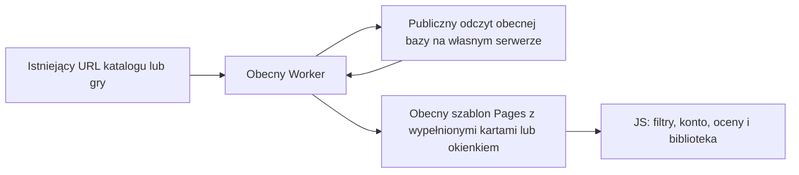

# Statyczny katalog, gry i publiczne Wskazówki — propozycja

Status: katalog nadal jest propozycją; zalecany prostszy wariant opisuje §11. Paczka publicznych dokumentów zatwierdzona do wdrożenia 2026-10-25. Stan kodu sprawdzony
na `origin/main` po E23 (4f05908f8). Wcześniejsze poprawki strony głównej
i HTTPS: [seo-bezpieczenstwo-plan.md](seo-bezpieczenstwo-plan.md).

## 1. Zakres i ustalenia użytkownika

- 2026-10-25: zgoda na wdrożenie przetestowanych publicznych dokumentów.
  Dla gier przygotować plan i ocenić prostsze wykonanie; bez zgody na
  implementację nowego katalogu w tej paczce.

- 2026-10-24: wykonać na branchu wszystkie pozostałe poprawki, bez nowego
  katalogu Gier Społeczności i bez publikacji na produkcji. Wskazówki i
  prywatność otrzymują pełny HTML przez Worker, z gotowej treści Markdown
  i słowników dołączonych do kodu, bez bazy ani nowej infrastruktury.
- Przyszły katalog ma zachować okienko gry: bezpośredni URL dostarcza HTML
  obecnego interfejsu z otwartym, wypełnionym okienkiem; nie narzuca osobnego
  wyglądu całej strony. Ten etap nie zmienia katalogu ani podglądu gier.

- Rozważyć statyczny katalog Gier Społeczności i poprawki pozostałych
  publicznych stron wskazanych w audycie.
- **Wskazówki są udostępnione wszystkim, mają działać i pomagać w
  wyszukiwaniu.** Ich obecne `noindex, nofollow` jest sprzeczne z celem;
  publiczne rozdziały mają otrzymać indeksowalny HTML.
- Ten dokument określa proponowane wykonanie. Nie zatwierdza nowej
  konfiguracji Cloudflare ani nie zmienia działającej aplikacji.

## 2. Co faktycznie wymaga zmiany

- Router Workera podaje botom inny HTML katalogu i gry niż przeglądarkom.
  Przeglądarka dostaje szablon katalogu z jego canonicalem także pod URL gry.
- Karty katalogu są przyciskami JS. W publicznym HTML powinny być linkami.
- Publiczna strona gry nie może zależeć od sesji ani wywołań RPC w przeglądarce.
- Publikację obsługuje API panelu Workera, lecz autor wycofuje grę także
  bezpośrednio przez RPC `market_withdraw`. Są też usunięcia i kaskady w bazie.
  Samo dopisanie odświeżenia w panelu admina nie obejmie wszystkich zmian.
- `market_game_by_slug` obsługuje zarówno gry publiczne, jak i własne
  nieopublikowane zgłoszenia autora. Publiczny generator musi jawnie brać
  wyłącznie `published`; prywatny podgląd trzeba zachować osobno.
- `market_games.updated_at` zmienia się również przy aktualizacji liczby
  kopii w bibliotekach. Nie nadaje się bezpośrednio na datę zmiany treści
  w sitemapie ani na wyzwalacz przebudowy całych stron.
- Treść Wskazówek jest już generowana z Markdown do modułów JS przez
  `scripts/manual/build-content.mjs`. Można z tego samego źródła generować HTML.

## 3. Warianty statycznego katalogu

| Wariant | Zalety | Koszt i ograniczenia |
|---|---|---|
| HTML generowany przy deployu GitHub Pages | Korzysta z obecnego hostingu, cały artefakt publikowany razem | Nowa gra lub wycofanie wymaga kolejnego deployu; potrzebny niezawodny wyzwalacz z bazy; zmiany danych uruchamiają publikację frontu |
| Gotowy HTML w osobnym R2, obsługiwany przez Worker | Zmiany katalogu niezależne od wdrożeń aplikacji; brak zapytania do bazy przy odczycie gotowej gry | Nowy bucket/binding, proces publikowania i kontrola spójności |
| Obecny renderer Workera rozszerzony na wszystkich, z cache | Najmniejsza przebudowa, pełny HTML dla ludzi i botów | To SSR z cache, a nie trwały statyczny katalog; zimny odczyt nadal wymaga bazy |

**Wariant trwałych plików: R2 + Worker.** Po ponownej ocenie 2026-10-25
rekomendacją pierwszego etapu jest prostszy SSR z §11; poniższy wariant
pozostaje opcją przy potrzebie niezależności od API/VPS.
Strona, style i JS pozostają na GitHub Pages. Nowy, osobny bucket zawiera
wyłącznie publiczne artefakty SEO, bez mieszania ich z kopiami zapasowymi.
Nie publikujemy `r2.dev` ani bezpośredniego publicznego dostępu do bucketa.

R2 ma [silną spójność odczytów po zapisie i usunięciu](https://developers.cloudflare.com/r2/reference/consistency/).
Dotyczy to pojedynczych obiektów, nie transakcji obejmującej wszystkie pliki.
Dlatego potrzebny jest spis aktywnej publikacji. Istniejące KV nie powinno
być jedynym źródłem decyzji o wycofaniu gry: [zmiany w KV propagują się z opóźnieniem](https://developers.cloudflare.com/kv/concepts/how-kv-works/).

## 4. Publiczny HTML i obecny interfejs

- Zachować adresy katalogu i `/marketplace/game/<slug>`; canonicale
  jednoznaczne, zgodne z językiem strony. Brak nowego adresu dla „wersji SEO”.
- Katalog: gotowa lista kart `<a href>` z tytułem, opisem i językiem.
  Przy obecnych około 90 grach można zawrzeć całą listę w HTML. Paginację
  dołożyć dopiero przy wzroście, jako zwykłe linki dostępne bez JS.
- PL/EN/UK dotyczą interfejsu katalogu. Każda gra ma własny język treści;
  nie tworzyć fikcyjnych trzech tłumaczeń tej samej gry.
- Gra: własny title, opis, canonical, H1, opis zestawu, pytania i odpowiedzi,
  link do katalogu, publiczne dane strukturalne zgodne z treścią gry.
  Pytań rozgrywki nie przedstawiać automatycznie jako FAQ serwisu.
- Osoby i roboty otrzymują tę samą publiczną treść. Usunąć zależność wyboru
  wersji katalogu/gry od User-Agent.
- Użyć istniejącego silnika stylów E23 i wspólnego renderera kart/treści;
  bez osobnego prostego wyglądu „dla Google”. HTML ma być widoczny bez JS,
  a klasy ładowania nie mogą go ukrywać do zakończenia logowania/tłumaczeń.
- Z JS zachować filtrowanie, wyszukiwanie, sortowanie, oceny i dodawanie
  do biblioteki. Publiczna treść nie czeka na te wywołania.
- Karta pozostaje prawdziwym linkiem: nowe okno, odświeżenie i bezpośrednie
  wejście działają. Zwykłe kliknięcie JS może nadal otwierać obecny podgląd;
  tytuł/canonical muszą podążać za URL i wracać do katalogu po zamknięciu.
- Stan „w moich grach”, własna ocena, lista oceniających dla autora,
  oczekujące zgłoszenia i notatki moderacji nie trafiają do odcisków.
  Podgląd własnego zgłoszenia pozostaje uwierzytelniony i poza indeksem.

## 5. Generowanie i spójna publikacja

Proponowany przepływ:

1. Zmiana danych i zapis zadania następują w tej samej transakcji bazy.
   Zadanie obejmuje także wycofanie przez autora i usunięcie w kaskadzie;
   przy usuwaniu zachowuje slug potrzebny do wyłączenia publicznego adresu.
2. Jeden uporządkowany proces publikuje zadania z kontrolą wersji źródła,
   ponowieniami i widocznym stanem błędu. Sama operacja `waitUntil` nie
   zastępuje trwałej kolejki. Ponowne wykonanie ma być bezpieczne.
3. Eksport zawiera wyłącznie dozwolone publiczne pola opublikowanych gier.
   Tytuły, opisy i odpowiedzi są tekstem, wymagają escapowania; JSON-LD
   nie może zamknąć znacznika script. Sekrety nie trafiają do artefaktów.
4. Generator zapisuje komplet nowych obiektów pod wersjonowanymi nazwami.
   Niezmienione strony gier można wykorzystać ponownie. Przed udostępnieniem
   sprawdza kompletność, języki, canonicale i poprawność danych strukturalnych.
5. Dopiero po walidacji atomowo aktualizuje jeden spis aktywnej publikacji.
   Równoczesne zadania nie mogą nadpisać nowszego stanu starszym odciskiem;
   potrzebna serializacja i warunkowy zapis spisu z kontrolą wersji/ETag.
6. Worker sprawdza aktualny spis, następnie odczytuje wskazany statyczny
   dokument. Odczyt strony nie wymaga bazy ani wyliczania treści gry.
   Nieznany/wycofany slug daje 404; brak pliku wymienionego w spisie lub
   awaria magazynu daje 503 z Retry-After, nie fałszywe 404 lub pusty katalog.
7. Wycofanie ma priorytet: blokada publicznego URL przed uznaniem operacji
   za zakończoną; potem potwierdzenie usunięcia z katalogu i sitemap.
   Zapis zadania nie jest jeszcze potwierdzeniem publicznego wycofania.
   Opóźnienie/błąd publikatora musi być widoczne, a stare zadanie nie może
   ponownie udostępnić już wycofanej gry.
8. Spisu widoczności nie wolno obsługiwać ze starego cache. Na początku
   bez długiego cache HTML w przeglądarce/CDN; ETag sprawdzany dopiero po
   weryfikacji aktualnej widoczności. Samo usunięcie obiektu z R2 nie usuwa
   odpowiedzi zapisanej wcześniej w CDN. Dłuższy cache wymaga osobno
   sprawdzonego unieważniania na wszystkich lokalizacjach.
9. Zmiana szablonu, słowników lub wersji zasobów wymaga przebudowy odcisków.
   Błąd budowania nie przełącza aktywnej publikacji na niekompletną wersję.
   Cofnięcie szablonu nie może przywrócić dawniej wycofanych gier.

Wdrożenie wymaga dodającej migracji (kolejka/wersje publikacji i daty treści),
nowego bindingu R2 oraz procesu publikatora. Dokładne RPC i leasing kolejki
należy doprecyzować przed implementacją; obecne RPC nie zapewniają takiej
transakcji pomiędzy bazą i magazynem obiektów. Nie zakładamy natychmiastowej
spójności obu usług po samym zapisie w bazie.

## 6. Daty i dane zmienne

- Rozdzielić zmianę treści od liczników: osobna rewizja/daty treści i
  publikacji; `updated_at` używane przez bieżącą aplikację zostawić zgodne wstecz.
- `lastmod` dotyczy znaczącej zmiany zawartości strony. Dodanie kopii do
  biblioteki, nowa ocena albo odnowienie cache nie zmieniają tej daty.
- Liczniki i oceny mogą mieć osobny krótki cache lub być dogrywane w JS;
  nie przebudowywać 90 stron po każdej ocenie/dodaniu do biblioteki.
- Sitemap powstaje z tego samego spisu opublikowanych dokumentów co katalog:
  bez adresów oczekujących, wycofanych, prywatnych podglądów i filtrów wyszukiwarki.

## 7. Wskazówki — publiczne i przeznaczone do wyszukiwania

- Rozszerzyć istniejący generator Markdown o pełny HTML spisu treści oraz
  każdego rozdziału w PL/EN/UK. Jedno źródło treści, bez ręcznej kopii SEO.
- Zachować `/manual/` i istniejące `?ch=<rozdział>`; Worker wybiera gotowy
  dokument zgodny z rozdziałem i językiem. Nie wymaga to nowego publicznego
  nazewnictwa tras ani przenumerowania podręcznika.
- Wdrożyć HTML razem z `index, follow`, title/opisem rozdziału, H1,
  canonicalem, wzajemnymi hreflangami i wpisami w sitemapie.
- Canonical zawiera tylko rozdział i język. Parametry kontekstowego powrotu
  (`from`, `ret`) i wyszukiwania nie tworzą kolejnych wersji do indeksowania.
  Kotwice podrozdziałów pozostają punktami w obrębie tego samego dokumentu.
- Spis treści, rozdziały i przyciski poprzedni/następny są linkami HTML.
  Wyszukiwanie, karuzele i powiększanie ilustracji są rozszerzeniem JS.
- Czytanie nie zależy od Supabase, konta, sesji ani dostępności API.
  Nieznany rozdział otrzymuje właściwe 404. Zrzuty mają opisy i wymiary.
- Linki do Wskazówek z głównej strony i katalogu oraz linki z instrukcji
  do publicznych gier mają być dostępne w HTML.

To można wykonać na istniejącym GitHub Pages, niezależnie od konfiguracji
R2 katalogu. Generator już posiada treść rozdziałów przy budowaniu aplikacji.

## 8. Pozostałe strony

| Strona | Proponowana poprawka |
|---|---|
| Prywatność | Gotowa treść PL/EN/UK, zgodny język/canonical/hreflang i opis; czytelność bez sesji/JS. Bez zmiany merytorycznej polityki w ramach tej paczki SEO. |
| `/404.html` | Status 404 także przy bezpośrednim wejściu, dokument techniczny z noindex; zachować pomocne linki. |
| `/maintenance/` | Bezpośredni dokument techniczny z noindex; rzeczywista przerwa serwisu nadal 503 i Retry-After. Nie przenosić noindex na normalne publiczne strony. |
| Logowanie, konto, biblioteki, edytory, ankiety, urządzenia | Zachować noindex i obowiązujące uprawnienia. Nie generować publicznych odcisków danych użytkownika. |
| Strona główna | Zachować wdrożone PL/EN/UK. Powiązać zwykłymi linkami z katalogiem i Wskazówkami; ewentualna sekcja wybranych gier ma korzystać z tego samego publicznego spisu. |

## 9. Kolejność i warunki zakończenia

1. Wskazówki oraz prywatność/techniczne dokumenty można przygotować bez nowej
   infrastruktury. Wskazówki: pełny HTML i otwarcie indeksowania razem.
2. Wydzielić publiczny model/renderer katalogu i gier zgodny z silnikiem E23.
   Osobno zachować uwierzytelniony podgląd własnych zgłoszeń i akcje konta.
3. Dodać kolejkę/wersje, publikator, R2 i spis. Wygenerować istniejące gry
   oraz katalogi; porównać z rzeczywistym zbiorem `published`.
4. Przełączyć publiczne trasy dopiero po kompletnej publikacji i testach;
   następnie usunąć podział HTML według User-Agent. Bez pustych stron w przejściu.
5. Sitemap i katalog sprawdzać wspólnie; zgłoszenie do Search Console po
   publikacji. Gotowy HTML poprawia dostępność treści, nie gwarantuje indeksacji.

Wymagane punktowe sprawdzenia:

- Bez JS: widoczny katalog, treść gry i rozdziału; działające linki/nawigacja.
- Ten sam publiczny HTML dla Googlebota i zwykłej przeglądarki; GET i HEAD
  spójne; poprawne języki/canonicale i brak noindex na publicznych Wskazówkach.
- Nowa gra, akceptacja, wycofanie autora/admina, usunięcie/kaskada, ponowienie
  i kolejność zdarzeń; brak danych oczekujących/prywatnych w HTML i sitemapie.
- Błąd bazy podczas budowania, błąd R2, niekompletna generacja, stary cache,
  zmiana szablonu, cofnięcie wersji; brak ponownego udostępnienia wycofanej gry.
- Z JS: logowanie, biblioteka, ocena, filtry, podgląd, Back/Forward, refresh,
  nowe okno oraz prywatny podgląd zgłoszenia; bez zmiany treści/canonicala na katalog.
- Wszystkie dotknięte trasy i parametry w PAGES/pageIdForPath i dokumentacji.
- Jedne szablony publiczne dla generatora i UI, PL/EN/UK, zrzuty telefonu
  i komputera, bramka brancha oraz kontrola po wdrożeniu.

## 10. Paczka bez katalogu — branch `codex/public-pages-seo`

Decyzja 2026-10-24: przygotować poprawki na branchu, bez publikowania main.

Wykonanie Wskazówek nie wymaga magazynu odcisków: istniejący generator
Markdown zapisuje gotowy HTML treści i opis rozdziału w modułach PL/EN/UK.
Worker dołącza te moduły przy budowaniu i wstawia treść do szablonu Pages.
Nie odpytuje bazy, sesji ani API podczas renderowania. Wspólny renderer
jest używany również przy przełączaniu rozdziałów w przeglądarce, więc
nie ma oddzielnej kopii układu dla SEO. To pełny HTML na brzegu sieci,
nie nowy proces publikowania plików i nie statyczny katalog gier z §5.

- Wszystkie 20 rozdziałów oraz spis treści w trzech językach: pełny HTML,
  index/follow, własny tytuł/opis, canonical tylko `ch` i `lang`, hreflang,
  HTML spisu i pagera. Link „Spis treści” w nagłówku rozdziału działa bez JS.
- Prywatność: obecne słowniki PL/EN/UK w HTML, canonical/hreflang/OG zgodne
  z językiem; treść polityki nie jest zmieniana w tej paczce.
- Czytelność treści nie czeka na auth ani JS. Dodatkowy arkusz `noscript`
  porządkuje pasek nawigacji bez JS; obecne działające linki są zachowane.
- Metadane zmieniają się również po przejściu w JS i zmianie języka.
  `from`, `ret`, filtry i kotwice nie tworzą indeksowanych kopii.
- Nieznany rozdział i bezpośredni `/404.html`: HTTP 404 i noindex.
  Samodzielna strona przerwy: noindex; rzeczywista bramka nadal 503/Retry-After.
- Sitemap: 63 adresy Wskazówek i brakujące wersje EN/UK prywatności;
  GET i HEAD zgodne. Istniejące wpisy i renderer gier pozostają bez przebudowy.
- Link do Wskazówek z katalogu jest zwykłym `<a>`; stronę główną już łączą
  linki HTML z Wskazówkami i katalogiem. Nie dodajemy sekcji wybranych gier,
  bo wymagałaby jeszcze niezrealizowanego publicznego spisu.
- Aktualizacja PAGES, obsługa dokumentów index.html, zachowanie kliknięcia
  linków w nowym oknie i zamykania arkuszy; prywatne strony zachowują noindex.
- Brak zmian bazy, R2, serwera, CSP strefy i mechanizmu publikacji gier.

Lokalnie: 10/10 testów na rzeczywistym silniku Workera (każdy rozdział i oba
UA, błędy, HEAD, sitemap, przerwa); 87/87 punktowych unitów aplikacji,
61/61 dodatkowych sprawdzeń (część pokrywa się z poprzednimi); i18n bez
nieużywanych kluczy, lint no-undef. Przeglądarka z wyłączonym API: 12
przypadków PL/EN/UK z JS i bez, nawigacja bez JS oraz telefon bez poziomego
przewijania. Zrzuty: 36 scen istniejącego interfejsu + 12 bez JS.
Brak wdrożenia i brak kontroli produkcji tego kodu — zgodnie z poleceniem.

Bramka brancha zakończona:

- `9b1121fd5`: implementacja; E2E 40142990874 — pięć przypadków zielonych,
  dwie nieaktualne asercje (wielkie litery CSS i dosłowny href).
- `fecff5b44`: zgodność ze starszym szablonem Pages, układ bez JS, poprawione
  asercje z zachowaniem ich celu; zły rozdział sprawdza rzeczywisty Worker
  zamiast oczekiwania powrotu do spisu w atrapianym frontendzie.
  [40143206972](https://github.com/Andrish97/familiada/actions/runs/40143206972)
  — 3/3 (publiczne języki/metadane, rozdziały, kontekstowy powrót na telefonie).
- `4bd3c1ed3`: href linków Wstecz/Wskazówki aktualizowany także po zmianie
  języka, z zachowaniem nowego okna; unity i
  [40143334514](https://github.com/Andrish97/familiada/actions/runs/40143334514)
  — 2/2 (bezpieczny powrót `ret`, zamykanie podglądu ilustracji).

Łącznie osiem różnych przypadków E2E zakończonych sukcesem; zielone przypadki
nie były powtarzane bez zmiany powiązanego kodu. Najnowszy kod publicznych
stron ponownie: workerd 6/6 + wcześniejsze 4/4 głównej, i18n bez nieużywanych
kluczy; budowanie `wrangler deploy --dry-run` zakończone bez publikacji
(267,67 KiB gzip). Drzewo nie zawiera plików testowego podglądu.
Wszystko pozostaje na branchu; produkcja, baza i katalog są bez zmian.

## 11. Prostszy plan dla gier — rekomendacja 2026-10-25

Status: propozycja po pytaniu użytkownika „czy nie da się tego zrobić prościej”.
Nie jest częścią zatwierdzonego wdrożenia publicznych dokumentów. §3–6
opisują alternatywę dla trwałych plików; R2 nie jest wymaganiem SEO.
Na pierwszy etap zalecany jest **obecny Worker + publiczny odczyt bazy +
pełny HTML tego samego interfejsu**, bez nowego hostingu i procesu publikacji.

### Co rzeczywiście jest potrzebne

Robot i człowiek mają otrzymać pod istniejącym URL gotowy katalog lub treść
gry w otwartym okienku, wraz z prawidłowym tytułem i canonicalem. HTML nie
musi istnieć jako plik na dysku. Można zbudować go na żądanie, podobnie do
publicznych Wskazówek, ale z danymi publicznych gier pobranymi z obecnego API.
Nie wystarczy przekazać wszystkim obecnego prostego dokumentu dla botów:
nie ma interfejsu aplikacji, a gra jest tam błędnie opisana jako FAQ.

### Zakres pierwszej paczki

1. **Jeden model publicznych danych.** Worker pobiera je z publicznym
   kluczem anon, bez przekazywania sesji/cookies użytkownika i bez używania
   listy administracyjnej z e-mailami/notatkami. Istniejący `market_browse`
   nie zwraca sluga i ucina wynik do 100 pozycji, więc nie daje poprawnego
   adresu karty. Najczytelniej dodać jedno małe, tylko odczytowe RPC
   `market_public_catalog`: wyłącznie opublikowane pozycje, slug, tytuł,
   opis, język i dozwolona publiczna nazwa autora; ewentualnie publiczne
   liczniki. Bez payloadów całej biblioteki i bez danych konta. Przy obecnym
   rozmiarze można zwrócić wszystkie nagłówki w jednym odczycie; przyszła
   paginacja musi mieć linki HTML, bez cichego obcięcia listy. To dodająca
   migracja, bez zmiany typu zwracanego obecnych RPC.
2. **Wspólny renderer interfejsu.** Wydzielić HTML kart oraz pytań/odpowiedzi
   z obecnego JS do modułu używanego przez Worker i przeglądarkę. Użyć
   obecnego silnika stylów, nie tworzyć osobnego wyglądu dla Google.
   Karta jest `<a href="/marketplace/game/slug">`; zwykły klik otwiera
   okienko, Ctrl/środkowy przycisk/nowa karta działają standardowo.
3. **Bezpośredni URL gry.** Worker pobiera publiczną grę po slugu
   (istniejące `market_game_by_slug` z anon, plus jawne sprawdzenie
   `status=published`) i wypełnia obecny szablon z otwartym okienkiem.
   Nadaje grze własny title, opis, canonical, H1 oraz publiczne dane
   strukturalne zgodne z grą, bez automatycznego FAQ. Język treści gry
   pozostaje jej rzeczywistym językiem; język przycisków może być PL/EN/UK.
   Parametr języka UI nie udaje tłumaczenia pytań. Dokładna polityka
   canonicala tych wariantów ma być wspólna dla renderera i klienta.
4. **Dołączenie JS bez kasowania treści.** Inicjalizacja przejmuje już
   wypełnione karty i okienko. Nie może czyścić ich na „Ładowanie…” ani
   uzależniać czytania od logowania. Dane osobiste (`in_library`, własne
   gwiazdki, oceniający dostępni autorowi) są pobierane oddzielnie po auth.
   Otwieranie/zamykanie, Back/Forward i zmiana języka synchronizują URL
   oraz metadane. Bez JS działają linki do katalogu i zamknięcie okienka
   jako zwykły powrót do katalogu; pytania/odpowiedzi pozostają czytelne.
5. **Prywatny podgląd autora.** Zachować obecne uwierzytelnione RPC własnych
   zgłoszeń. Ten stan nie trafia do publicznego SSR ani sitemap. Nie można
   po prostu zacząć 404-ować każdego niepublicznego sluga przed startem JS,
   bo zepsuje to obecny refresh podglądu autora. Najprościej rozdzielić
   te stany w tym samym katalogu: publiczne `/marketplace/game/slug`, a
   prywatny podgląd autora przez już obsługiwany parametr `?game=<id>`,
   bez indeksowania i bez przepisywania na publiczny slug dla niepublicznej
   gry. Zachować zwykłe opublikowane gry pod canonicalnym slugiem.
   Parametr gry jako stan prywatnego podglądu wymaga wpisu w PAGES, testów,
   dokumentacji i Wskazówek PL/EN/UK. Nie dodaje strony ani nowego parametru.
6. **Bez cache HTML na początek.** Każde publiczne wejście odczytuje
   aktualny stan bazy, HTML ma `no-store`; brak R2, KV z odciskami, kolejki,
   webhooków i synchronizacji plików. Po zatwierdzeniu wycofania kolejne
   odczyty nie publikują gry — także po RPC autora, admina lub usunięciu
   w kaskadzie. Rozpoczętej wcześniej odpowiedzi i otwartego okienka nie da
   się cofnąć. Cache statycznych CSS/JS/obrazów zostaje bez zmian.
7. **Mapa i błędy.** Sitemap korzysta z tego samego publicznego źródła
   listy, bez administracyjnych pól. Na początku również bez starego cache
   wpisów gier. Brak/wycofanie = 404; timeout/awaria bazy = 503 i Retry-After,
   nie pusta lista z 200 i nie rekurencyjny `fetch(request)` tego samego
   Workera. Ograniczyć czas pobrania. `lastmod` gier na razie pominąć:
   obecny `updated_at` zmienia się od liczników; brak daty jest lepszy od
   fałszywej. Osobna data zmiany treści nie blokuje tej paczki.
8. **Przełączenie po sprawdzeniu obu widoków.** Usunąć wybór HTML katalogu
   i gry według User-Agent. Nie zmieniać bramki przerwy, uprawnień akcji
   konta, logowania ani widoków urządzeń. Sprawdzić też, że reguły strefy
   Cloudflare nie wymuszają cache wbrew `no-store`.

### Czego dzięki temu nie trzeba utrzymywać

| Wariant | Publikowanie zmian gier | Nowe elementy | Zachowanie przy awarii API |
|---|---|---|---|
| Zalecany pierwszy etap: Worker SSR bez cache HTML | Zmiana w bazie jest źródłem kolejnego odczytu | Małe RPC listy + wspólny renderer i inicjalizacja JS | Kontrolowane 503; bez generowania pustych stron |
| Gotowe HTML na własnym serwerze | Publikator po każdej zmianie widoczności, atomowe podmiany plików | Generator, kolejka/retry lub pełna przebudowa, katalog plików, reguły Caddy/Workera | Pliki mogą działać, jeżeli działa serwer WWW; wspólna awaria VPS wyłącza również pliki |
| Gotowe HTML w R2 | Publikator, trwałe zadania i kontrola aktywnej wersji | R2, binding, generator, spis, retry i kontrola wycofań | Gotowe strony mogą działać niezależnie od VPS; aktualizacje wymagają bazy/publikatora |

Własny serwer już obsługuje API/bazę. Nie trzeba teraz przenosić na niego
frontendu ani uruchamiać Node tylko dla SEO. SSR dokłada odczyt bazy do
wejścia publicznego; to jego koszt i ograniczenie dostępności. Przy obecnej
skali jest rozsądnym punktem startu, lecz pomiar opóźnień i obciążenia jest
warunkiem wdrożenia, nie założeniem o nieograniczonej wydajności.

### Weryfikacja i kolejność

- Najpierw test publicznego źródła danych: wyłącznie `published`, brak
  prywatnych pól, stabilne slugi, pełna lista bez limitu 100.
- Wspólny renderer i przejęcie HTML w JS: jeden etap z testami wszystkich
  trybów (anon, konto, autor, nowa karta, refresh, Back/Forward, zamknięcie,
  filtr, język). Osobno sprawdzić prywatny podgląd po odświeżeniu.
- Rzeczywisty Worker: ten sam HTML dla obu UA, treść bez JS, GET/HEAD,
  canonical zgodny z URL, XSS w tytułach/opisach/odpowiedziach; biblioteka
  i własne oceny nigdy nie trafiają do współdzielonego dokumentu.
- SQL i publiczne odczyty po akceptacji, wycofaniu autora/admina i kasowaniu;
  timeout/awaria API = 503. Żadnych utrwalonych publicznych kopii zgłoszeń.
- Punktowe E2E, PL/EN/UK, telefon/komputer, pomiar TTFB i liczby wywołań API.
  Dopiero po tej bramce przełączenie produkcji i sprawdzenie sitemap.
- Po publikacji odczyt HTML w Search Console. Pełny HTML ułatwia Google
  odczyt treści; nie jest obietnicą indeksowania wszystkich gier.

Cache dołożyć dopiero, gdy pomiar wskaże taką potrzebę. Krótki TTL oznacza
jawnie zaakceptowane opóźnienie wycofania; natychmiastowa kontrola statusu
przed podaniem cache nadal wymaga bazy. Odporność publicznego katalogu na
awarię całego VPS to osobny powód powrotu do R2 i §5, nie warunek poprawy SEO.

2026-10-25: integracja `e70c80ab5` z aktualnym main zweryfikowana: unity
69/69, workerd 10/10, branch E2E
[40168072561](https://github.com/Andrish97/familiada/actions/runs/40168072561)
5/5. Zgoda na publikację dotyczy §10; §11 pozostaje planem dla gier.
