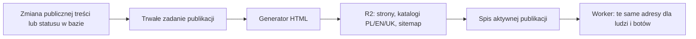

# Statyczny katalog, gry i publiczne Wskazówki — propozycja

Status: plan do oceny, bez wdrożenia tej przebudowy. Stan kodu sprawdzony
na `origin/main` po E23 (4f05908f8). Wcześniejsze poprawki strony głównej
i HTTPS: [seo-bezpieczenstwo-plan.md](seo-bezpieczenstwo-plan.md).

## 1. Zakres i ustalenia użytkownika

- Rozważyć statyczny katalog Gier Społeczności i poprawki pozostałych
  publicznych stron wskazanych w audycie.
- **Wskazówki są udostępnione wszystkim, mają działać i pomagać w
  wyszukiwaniu.** Ich obecne `noindex, nofollow` jest sprzeczne z celem;
  publiczne rozdziały mają otrzymać indeksowalny HTML.
- Ten dokument określa proponowane wykonanie. Nie zatwierdza nowej
  konfiguracji Cloudflare ani nie zmienia działającej aplikacji.

## 2. Co faktycznie wymaga zmiany

- Router Workera podaje botom inny HTML katalogu i gry niż przeglądarkom.
  Przeglądarka dostaje szablon katalogu z jego canonicalem także pod URL gry.
- Karty katalogu są przyciskami JS. W publicznym HTML powinny być linkami.
- Publiczna strona gry nie może zależeć od sesji ani wywołań RPC w przeglądarce.
- Publikację obsługuje API panelu Workera, lecz autor wycofuje grę także
  bezpośrednio przez RPC `market_withdraw`. Są też usunięcia i kaskady w bazie.
  Samo dopisanie odświeżenia w panelu admina nie obejmie wszystkich zmian.
- `market_game_by_slug` obsługuje zarówno gry publiczne, jak i własne
  nieopublikowane zgłoszenia autora. Publiczny generator musi jawnie brać
  wyłącznie `published`; prywatny podgląd trzeba zachować osobno.
- `market_games.updated_at` zmienia się również przy aktualizacji liczby
  kopii w bibliotekach. Nie nadaje się bezpośrednio na datę zmiany treści
  w sitemapie ani na wyzwalacz przebudowy całych stron.
- Treść Wskazówek jest już generowana z Markdown do modułów JS przez
  `scripts/manual/build-content.mjs`. Można z tego samego źródła generować HTML.

## 3. Warianty statycznego katalogu

| Wariant | Zalety | Koszt i ograniczenia |
|---|---|---|
| HTML generowany przy deployu GitHub Pages | Korzysta z obecnego hostingu, cały artefakt publikowany razem | Nowa gra lub wycofanie wymaga kolejnego deployu; potrzebny niezawodny wyzwalacz z bazy; zmiany danych uruchamiają publikację frontu |
| Gotowy HTML w osobnym R2, obsługiwany przez Worker | Zmiany katalogu niezależne od wdrożeń aplikacji; brak zapytania do bazy przy odczycie gotowej gry | Nowy bucket/binding, proces publikowania i kontrola spójności |
| Obecny renderer Workera rozszerzony na wszystkich, z cache | Najmniejsza przebudowa, pełny HTML dla ludzi i botów | To SSR z cache, a nie trwały statyczny katalog; zimny odczyt nadal wymaga bazy |

**Rekomendacja dla docelowego, rzeczywiście statycznego katalogu: R2 + Worker.**
Strona, style i JS pozostają na GitHub Pages. Nowy, osobny bucket zawiera
wyłącznie publiczne artefakty SEO, bez mieszania ich z kopiami zapasowymi.
Nie publikujemy `r2.dev` ani bezpośredniego publicznego dostępu do bucketa.

R2 ma [silną spójność odczytów po zapisie i usunięciu](https://developers.cloudflare.com/r2/reference/consistency/).
Dotyczy to pojedynczych obiektów, nie transakcji obejmującej wszystkie pliki.
Dlatego potrzebny jest spis aktywnej publikacji. Istniejące KV nie powinno
być jedynym źródłem decyzji o wycofaniu gry: [zmiany w KV propagują się z opóźnieniem](https://developers.cloudflare.com/kv/concepts/how-kv-works/).

## 4. Publiczny HTML i obecny interfejs

- Zachować adresy katalogu i `/marketplace/game/<slug>`; canonicale
  jednoznaczne, zgodne z językiem strony. Brak nowego adresu dla „wersji SEO”.
- Katalog: gotowa lista kart `<a href>` z tytułem, opisem i językiem.
  Przy obecnych około 90 grach można zawrzeć całą listę w HTML. Paginację
  dołożyć dopiero przy wzroście, jako zwykłe linki dostępne bez JS.
- PL/EN/UK dotyczą interfejsu katalogu. Każda gra ma własny język treści;
  nie tworzyć fikcyjnych trzech tłumaczeń tej samej gry.
- Gra: własny title, opis, canonical, H1, opis zestawu, pytania i odpowiedzi,
  link do katalogu, publiczne dane strukturalne zgodne z treścią gry.
  Pytań rozgrywki nie przedstawiać automatycznie jako FAQ serwisu.
- Osoby i roboty otrzymują tę samą publiczną treść. Usunąć zależność wyboru
  wersji katalogu/gry od User-Agent.
- Użyć istniejącego silnika stylów E23 i wspólnego renderera kart/treści;
  bez osobnego prostego wyglądu „dla Google”. HTML ma być widoczny bez JS,
  a klasy ładowania nie mogą go ukrywać do zakończenia logowania/tłumaczeń.
- Z JS zachować filtrowanie, wyszukiwanie, sortowanie, oceny i dodawanie
  do biblioteki. Publiczna treść nie czeka na te wywołania.
- Karta pozostaje prawdziwym linkiem: nowe okno, odświeżenie i bezpośrednie
  wejście działają. Zwykłe kliknięcie JS może nadal otwierać obecny podgląd;
  tytuł/canonical muszą podążać za URL i wracać do katalogu po zamknięciu.
- Stan „w moich grach”, własna ocena, lista oceniających dla autora,
  oczekujące zgłoszenia i notatki moderacji nie trafiają do odcisków.
  Podgląd własnego zgłoszenia pozostaje uwierzytelniony i poza indeksem.

## 5. Generowanie i spójna publikacja

Proponowany przepływ:

1. Zmiana danych i zapis zadania następują w tej samej transakcji bazy.
   Zadanie obejmuje także wycofanie przez autora i usunięcie w kaskadzie;
   przy usuwaniu zachowuje slug potrzebny do wyłączenia publicznego adresu.
2. Jeden uporządkowany proces publikuje zadania z kontrolą wersji źródła,
   ponowieniami i widocznym stanem błędu. Sama operacja `waitUntil` nie
   zastępuje trwałej kolejki. Ponowne wykonanie ma być bezpieczne.
3. Eksport zawiera wyłącznie dozwolone publiczne pola opublikowanych gier.
   Tytuły, opisy i odpowiedzi są tekstem, wymagają escapowania; JSON-LD
   nie może zamknąć znacznika script. Sekrety nie trafiają do artefaktów.
4. Generator zapisuje komplet nowych obiektów pod wersjonowanymi nazwami.
   Niezmienione strony gier można wykorzystać ponownie. Przed udostępnieniem
   sprawdza kompletność, języki, canonicale i poprawność danych strukturalnych.
5. Dopiero po walidacji atomowo aktualizuje jeden spis aktywnej publikacji.
   Równoczesne zadania nie mogą nadpisać nowszego stanu starszym odciskiem;
   potrzebna serializacja i warunkowy zapis spisu z kontrolą wersji/ETag.
6. Worker sprawdza aktualny spis, następnie odczytuje wskazany statyczny
   dokument. Odczyt strony nie wymaga bazy ani wyliczania treści gry.
   Nieznany/wycofany slug daje 404; brak pliku wymienionego w spisie lub
   awaria magazynu daje 503 z Retry-After, nie fałszywe 404 lub pusty katalog.
7. Wycofanie ma priorytet: blokada publicznego URL przed uznaniem operacji
   za zakończoną; potem potwierdzenie usunięcia z katalogu i sitemap.
   Zapis zadania nie jest jeszcze potwierdzeniem publicznego wycofania.
   Opóźnienie/błąd publikatora musi być widoczne, a stare zadanie nie może
   ponownie udostępnić już wycofanej gry.
8. Spisu widoczności nie wolno obsługiwać ze starego cache. Na początku
   bez długiego cache HTML w przeglądarce/CDN; ETag sprawdzany dopiero po
   weryfikacji aktualnej widoczności. Samo usunięcie obiektu z R2 nie usuwa
   odpowiedzi zapisanej wcześniej w CDN. Dłuższy cache wymaga osobno
   sprawdzonego unieważniania na wszystkich lokalizacjach.
9. Zmiana szablonu, słowników lub wersji zasobów wymaga przebudowy odcisków.
   Błąd budowania nie przełącza aktywnej publikacji na niekompletną wersję.
   Cofnięcie szablonu nie może przywrócić dawniej wycofanych gier.

Wdrożenie wymaga dodającej migracji (kolejka/wersje publikacji i daty treści),
nowego bindingu R2 oraz procesu publikatora. Dokładne RPC i leasing kolejki
należy doprecyzować przed implementacją; obecne RPC nie zapewniają takiej
transakcji pomiędzy bazą i magazynem obiektów. Nie zakładamy natychmiastowej
spójności obu usług po samym zapisie w bazie.

## 6. Daty i dane zmienne

- Rozdzielić zmianę treści od liczników: osobna rewizja/daty treści i
  publikacji; `updated_at` używane przez bieżącą aplikację zostawić zgodne wstecz.
- `lastmod` dotyczy znaczącej zmiany zawartości strony. Dodanie kopii do
  biblioteki, nowa ocena albo odnowienie cache nie zmieniają tej daty.
- Liczniki i oceny mogą mieć osobny krótki cache lub być dogrywane w JS;
  nie przebudowywać 90 stron po każdej ocenie/dodaniu do biblioteki.
- Sitemap powstaje z tego samego spisu opublikowanych dokumentów co katalog:
  bez adresów oczekujących, wycofanych, prywatnych podglądów i filtrów wyszukiwarki.

## 7. Wskazówki — publiczne i przeznaczone do wyszukiwania

- Rozszerzyć istniejący generator Markdown o pełny HTML spisu treści oraz
  każdego rozdziału w PL/EN/UK. Jedno źródło treści, bez ręcznej kopii SEO.
- Zachować `/manual/` i istniejące `?ch=<rozdział>`; Worker wybiera gotowy
  dokument zgodny z rozdziałem i językiem. Nie wymaga to nowego publicznego
  nazewnictwa tras ani przenumerowania podręcznika.
- Wdrożyć HTML razem z `index, follow`, title/opisem rozdziału, H1,
  canonicalem, wzajemnymi hreflangami i wpisami w sitemapie.
- Canonical zawiera tylko rozdział i język. Parametry kontekstowego powrotu
  (`from`, `ret`) i wyszukiwania nie tworzą kolejnych wersji do indeksowania.
  Kotwice podrozdziałów pozostają punktami w obrębie tego samego dokumentu.
- Spis treści, rozdziały i przyciski poprzedni/następny są linkami HTML.
  Wyszukiwanie, karuzele i powiększanie ilustracji są rozszerzeniem JS.
- Czytanie nie zależy od Supabase, konta, sesji ani dostępności API.
  Nieznany rozdział otrzymuje właściwe 404. Zrzuty mają opisy i wymiary.
- Linki do Wskazówek z głównej strony i katalogu oraz linki z instrukcji
  do publicznych gier mają być dostępne w HTML.

To można wykonać na istniejącym GitHub Pages, niezależnie od konfiguracji
R2 katalogu. Generator już posiada treść rozdziałów przy budowaniu aplikacji.

## 8. Pozostałe strony

| Strona | Proponowana poprawka |
|---|---|
| Prywatność | Gotowa treść PL/EN/UK, zgodny język/canonical/hreflang i opis; czytelność bez sesji/JS. Bez zmiany merytorycznej polityki w ramach tej paczki SEO. |
| `/404.html` | Status 404 także przy bezpośrednim wejściu, dokument techniczny z noindex; zachować pomocne linki. |
| `/maintenance/` | Bezpośredni dokument techniczny z noindex; rzeczywista przerwa serwisu nadal 503 i Retry-After. Nie przenosić noindex na normalne publiczne strony. |
| Logowanie, konto, biblioteki, edytory, ankiety, urządzenia | Zachować noindex i obowiązujące uprawnienia. Nie generować publicznych odcisków danych użytkownika. |
| Strona główna | Zachować wdrożone PL/EN/UK. Powiązać zwykłymi linkami z katalogiem i Wskazówkami; ewentualna sekcja wybranych gier ma korzystać z tego samego publicznego spisu. |

## 9. Kolejność i warunki zakończenia

1. Wskazówki oraz prywatność/techniczne dokumenty można przygotować bez nowej
   infrastruktury. Wskazówki: pełny HTML i otwarcie indeksowania razem.
2. Wydzielić publiczny model/renderer katalogu i gier zgodny z silnikiem E23.
   Osobno zachować uwierzytelniony podgląd własnych zgłoszeń i akcje konta.
3. Dodać kolejkę/wersje, publikator, R2 i spis. Wygenerować istniejące gry
   oraz katalogi; porównać z rzeczywistym zbiorem `published`.
4. Przełączyć publiczne trasy dopiero po kompletnej publikacji i testach;
   następnie usunąć podział HTML według User-Agent. Bez pustych stron w przejściu.
5. Sitemap i katalog sprawdzać wspólnie; zgłoszenie do Search Console po
   publikacji. Gotowy HTML poprawia dostępność treści, nie gwarantuje indeksacji.

Wymagane punktowe sprawdzenia:

- Bez JS: widoczny katalog, treść gry i rozdziału; działające linki/nawigacja.
- Ten sam publiczny HTML dla Googlebota i zwykłej przeglądarki; GET i HEAD
  spójne; poprawne języki/canonicale i brak noindex na publicznych Wskazówkach.
- Nowa gra, akceptacja, wycofanie autora/admina, usunięcie/kaskada, ponowienie
  i kolejność zdarzeń; brak danych oczekujących/prywatnych w HTML i sitemapie.
- Błąd bazy podczas budowania, błąd R2, niekompletna generacja, stary cache,
  zmiana szablonu, cofnięcie wersji; brak ponownego udostępnienia wycofanej gry.
- Z JS: logowanie, biblioteka, ocena, filtry, podgląd, Back/Forward, refresh,
  nowe okno oraz prywatny podgląd zgłoszenia; bez zmiany treści/canonicala na katalog.
- Wszystkie dotknięte trasy i parametry w PAGES/pageIdForPath i dokumentacji.
- Jedne szablony publiczne dla generatora i UI, PL/EN/UK, zrzuty telefonu
  i komputera, bramka brancha oraz kontrola po wdrożeniu.
