# Zrzuty — 2026-10-23 14:49 UTC

### Ustawienia wyglądu — pl · desktop

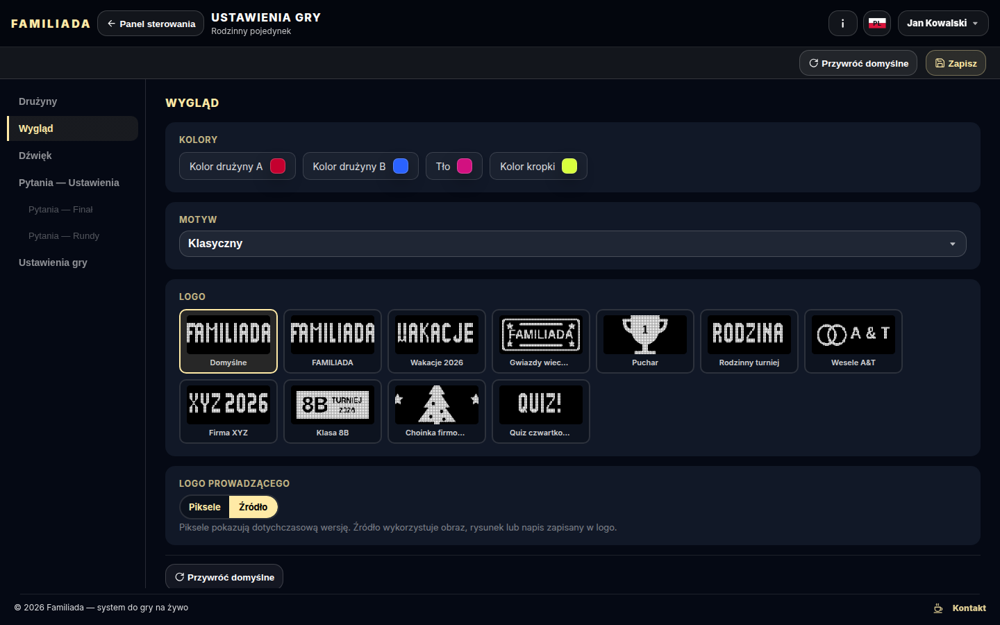

### Ustawienia wyglądu — en · desktop

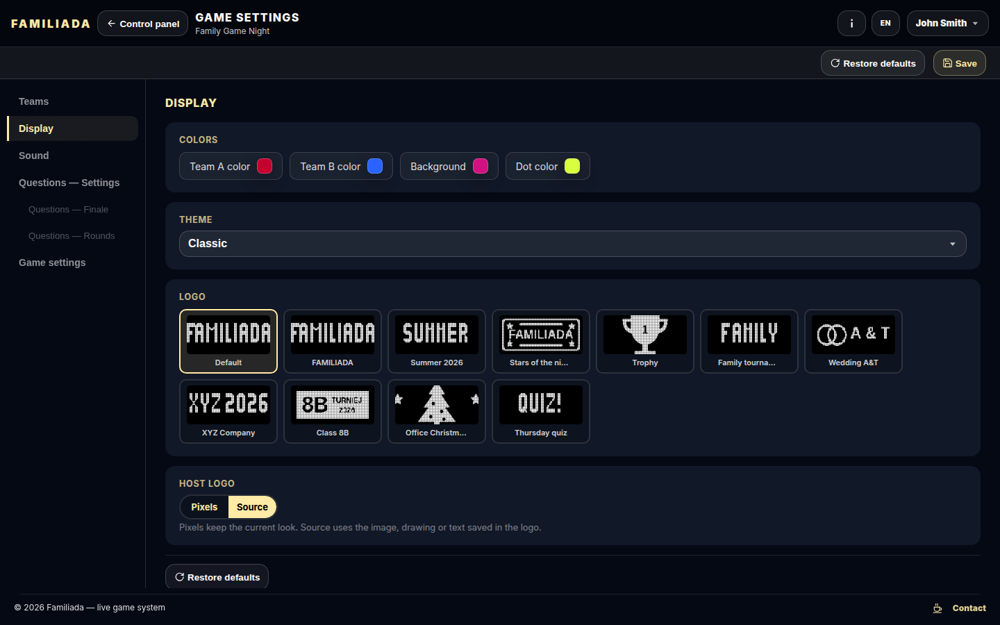

### Ustawienia wyglądu — uk · desktop

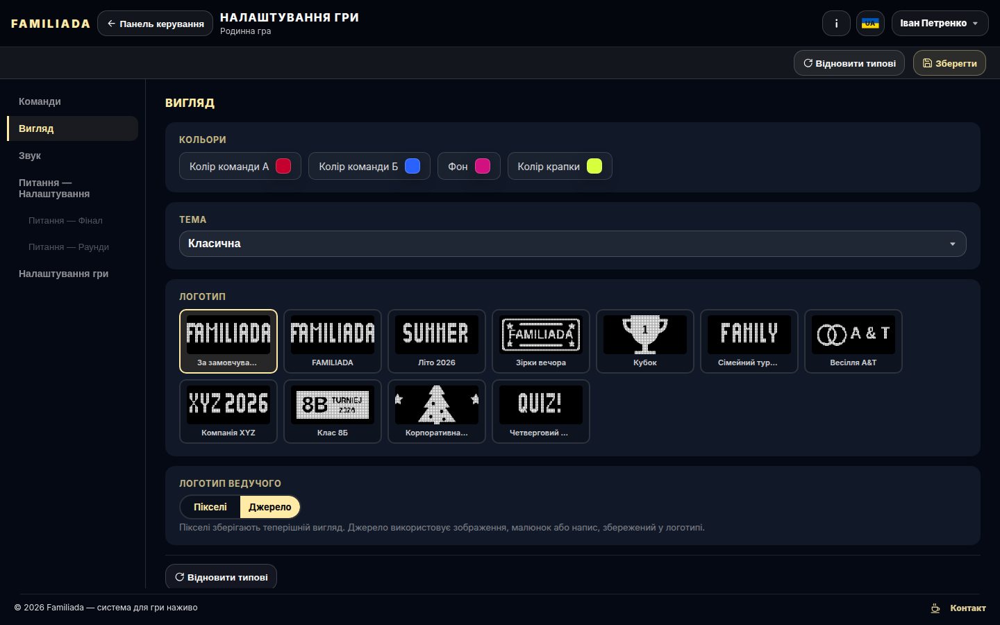

### Prowadzący — runda — pl · desktop

### Prowadzący — runda — en · desktop

### Prowadzący — runda — uk · desktop

### Wyświetlacz — runda — pl · desktop

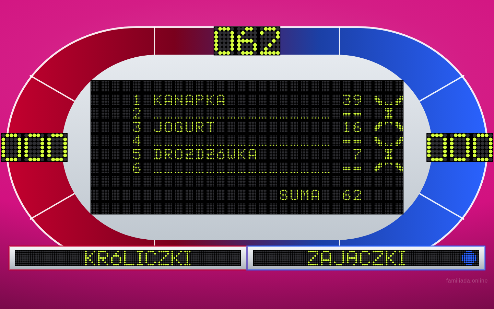

### Wyświetlacz — runda — en · desktop

### Wyświetlacz — runda — uk · desktop

### Panel sterowania — podsumowanie — pl · desktop

### Panel sterowania — podsumowanie — en · desktop

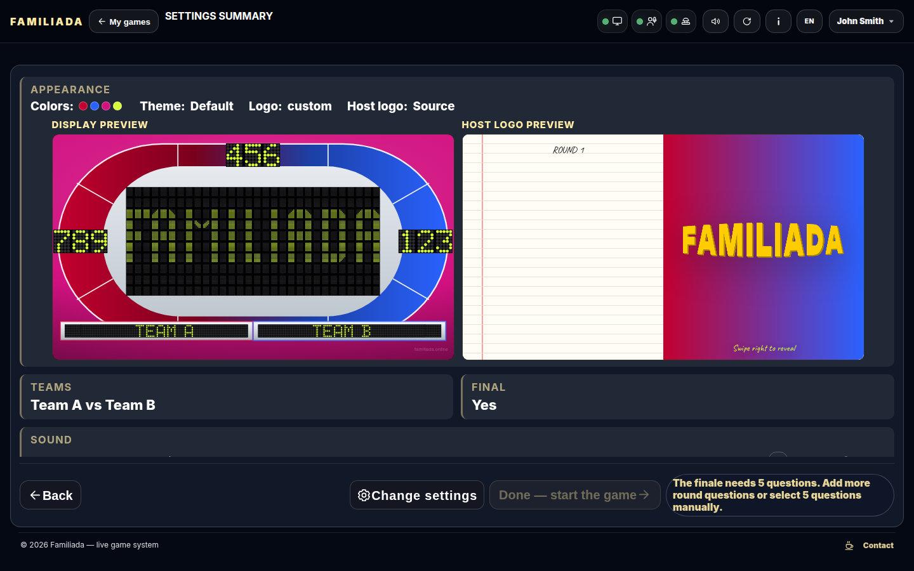

### Panel sterowania — podsumowanie — uk · desktop

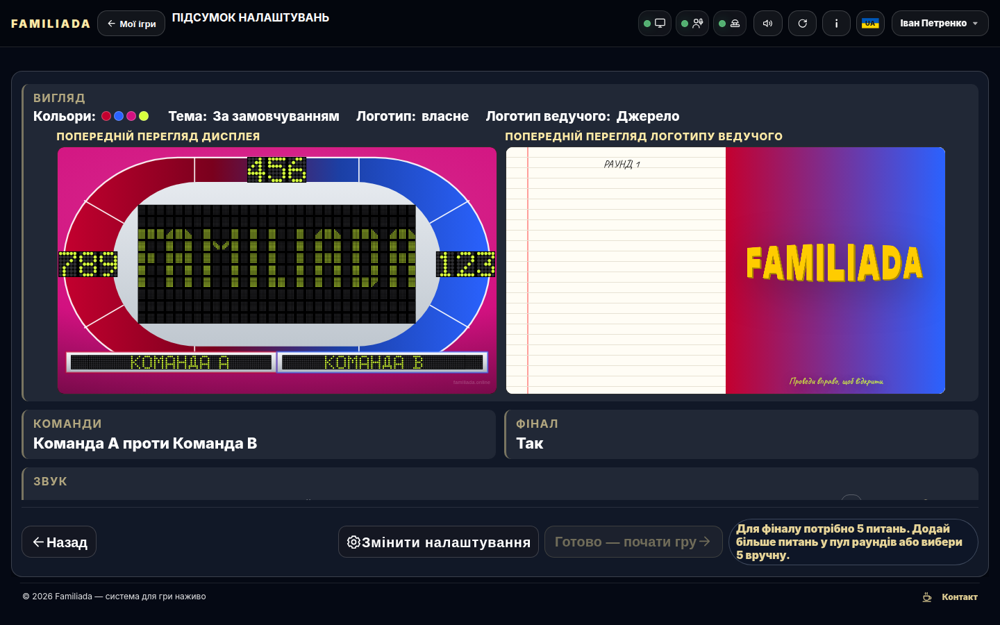

### Główny Wyświetlacz — pl · 1600×900

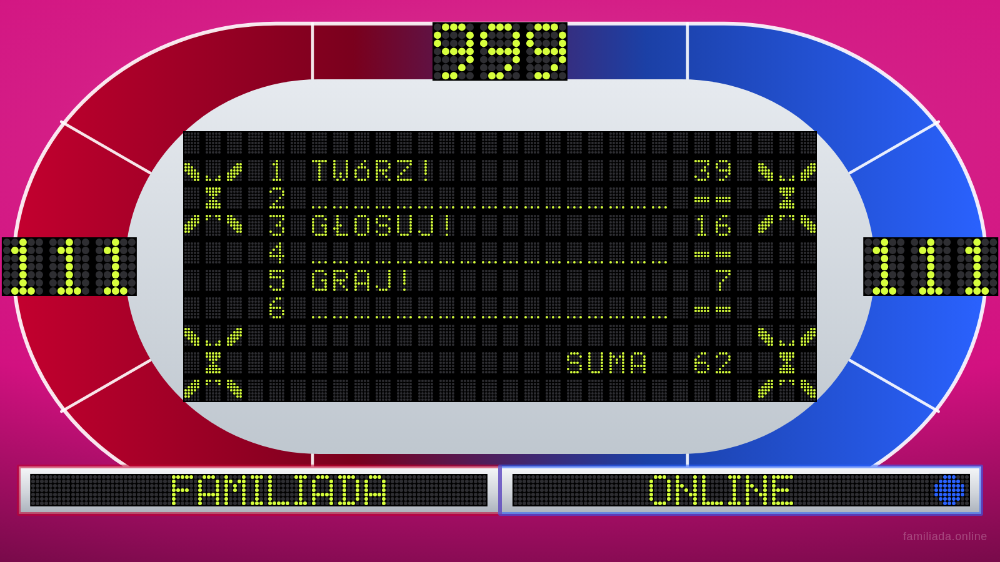

### Główny Wyświetlacz — en · 1600×900

### Główny Wyświetlacz — uk · 1600×900

### Podgląd linku (og:image) — pl · 1200×630

### Podgląd linku (og:image) — en · 1200×630

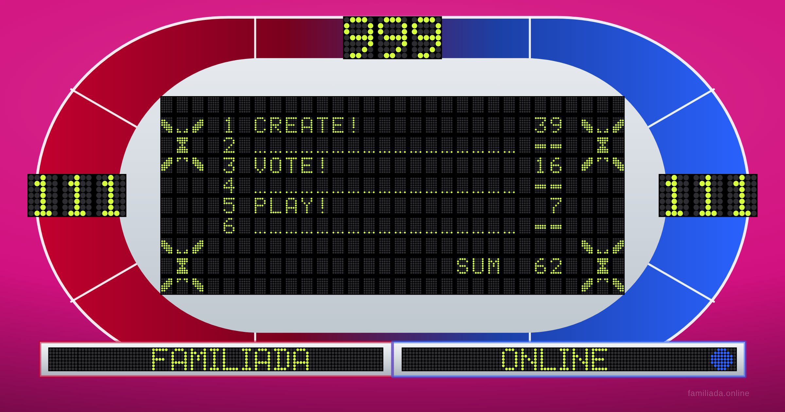

### Podgląd linku (og:image) — uk · 1200×630

### Ustawienia gry — wygląd i logo Prowadzącego — pl · desktop

### Ustawienia gry — wygląd i logo Prowadzącego — pl · phone

### Ustawienia gry — wygląd i logo Prowadzącego — en · desktop

### Ustawienia gry — wygląd i logo Prowadzącego — en · phone

### Ustawienia gry — wygląd i logo Prowadzącego — uk · desktop

### Ustawienia gry — wygląd i logo Prowadzącego — uk · phone

### Ustawienia gry — logo domyślne w trybie Piksele — pl · desktop

### Ustawienia gry — logo domyślne w trybie Piksele — pl · phone

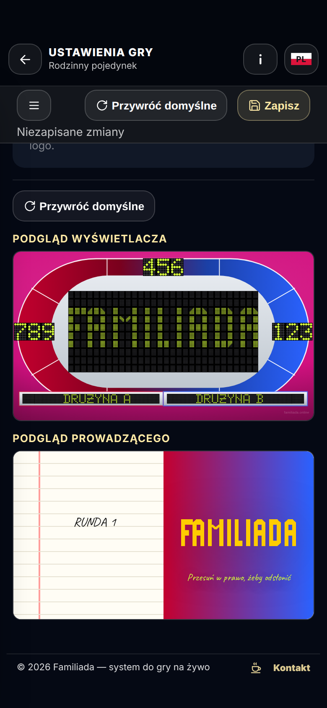

### Ustawienia gry — logo domyślne w trybie Piksele — en · desktop

### Ustawienia gry — logo domyślne w trybie Piksele — en · phone

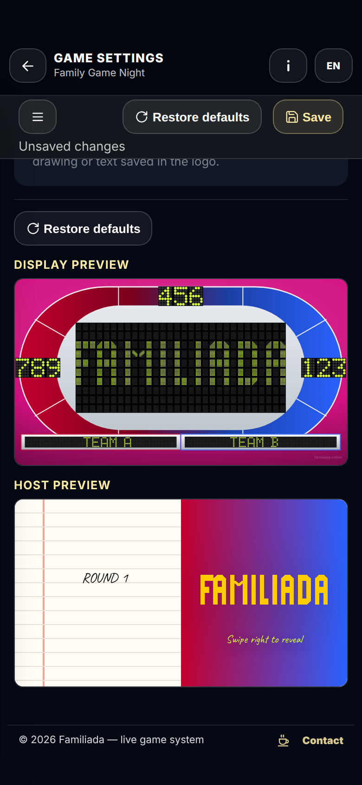

### Ustawienia gry — logo domyślne w trybie Piksele — uk · desktop

### Ustawienia gry — logo domyślne w trybie Piksele — uk · phone

### Wyświetlacz — niskie okno komputera (1400×550): Za małe okno — pl · 1400×550

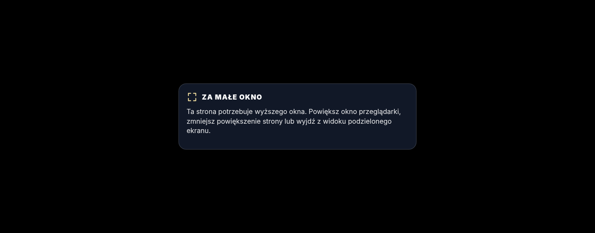

### Wyświetlacz — niskie okno komputera (1400×550): Za małe okno — en · 1400×550

### Wyświetlacz — niskie okno komputera (1400×550): Za małe okno — uk · 1400×550

### Wyświetlacz — logo gry na starcie (nazwy drużyn) — pl · 1600×900

### Wyświetlacz — logo gry na starcie (nazwy drużyn) — en · 1600×900

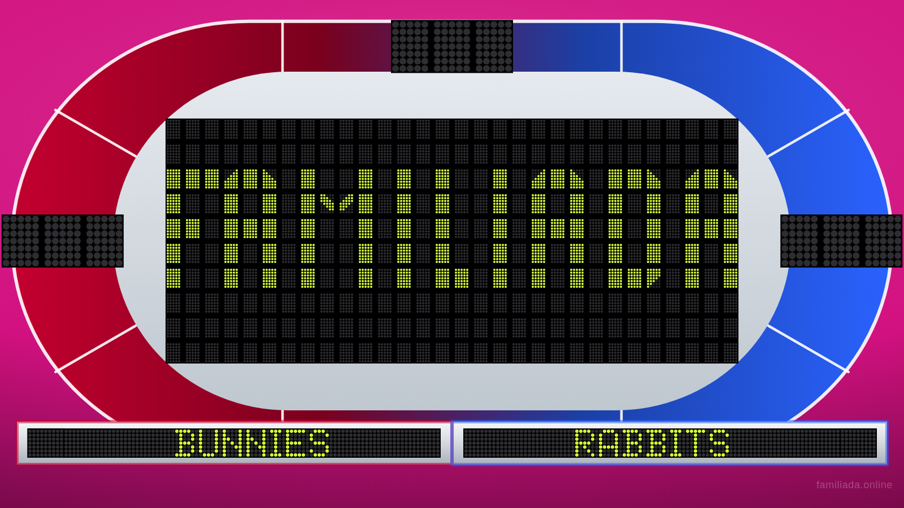

### Wyświetlacz — logo gry na starcie (nazwy drużyn) — uk · 1600×900

### Wyświetlacz — pojedynek: pusta plansza i lampka drużyny — pl · 1600×900

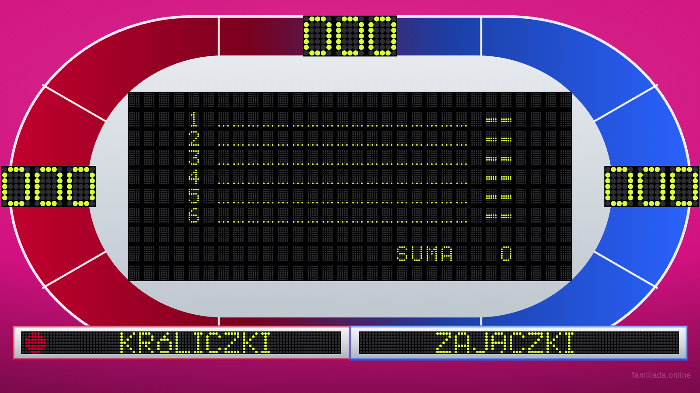

### Wyświetlacz — pojedynek: pusta plansza i lampka drużyny — en · 1600×900

### Wyświetlacz — pojedynek: pusta plansza i lampka drużyny — uk · 1600×900

### Wyświetlacz — przejęcie: trzy X drużyny B, duży X drużyny A — pl · 1600×900

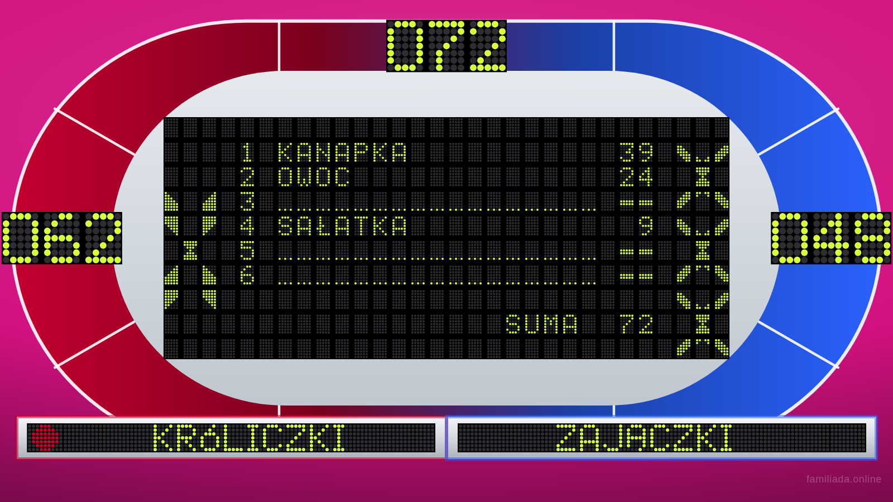

### Wyświetlacz — przejęcie: trzy X drużyny B, duży X drużyny A — en · 1600×900

### Wyświetlacz — przejęcie: trzy X drużyny B, duży X drużyny A — uk · 1600×900

### Wyświetlacz — rozgrywka: odsłonięte odpowiedzi, pula i jeden X — pl · 1600×900

### Wyświetlacz — rozgrywka: odsłonięte odpowiedzi, pula i jeden X — en · 1600×900

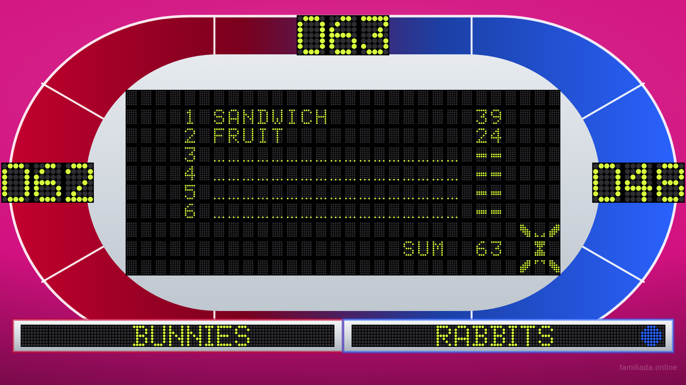

### Wyświetlacz — rozgrywka: odsłonięte odpowiedzi, pula i jeden X — uk · 1600×900

### Wyświetlacz — finał po graczu 1: odpowiedzi i suma — pl · 1600×900

### Wyświetlacz — finał po graczu 1: odpowiedzi i suma — en · 1600×900

### Wyświetlacz — finał po graczu 1: odpowiedzi i suma — uk · 1600×900

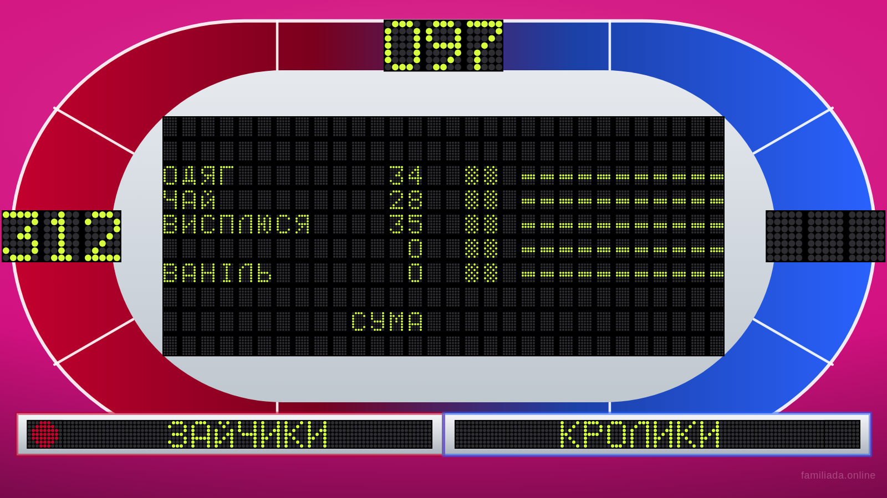

### Wyświetlacz — plansza finału: odpowiedzi gracza 1 i 2 — pl · 1600×900

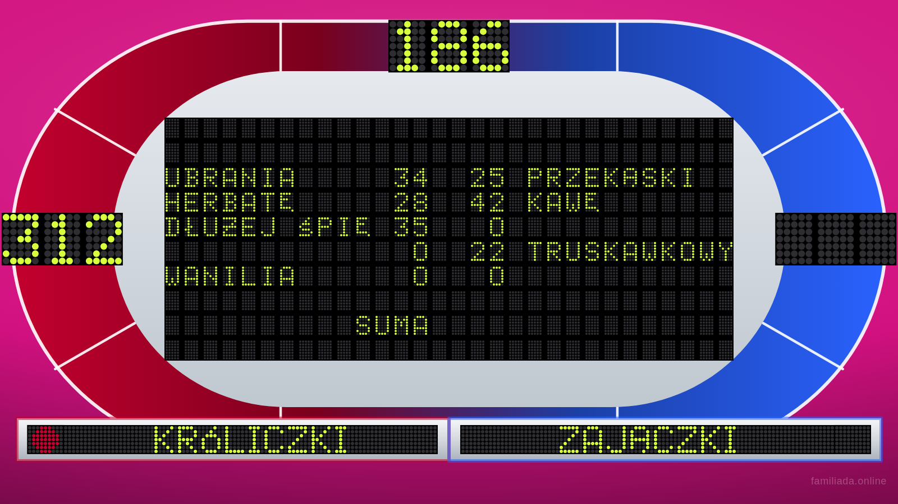

### Wyświetlacz — plansza finału: odpowiedzi gracza 1 i 2 — en · 1600×900

### Wyświetlacz — plansza finału: odpowiedzi gracza 1 i 2 — uk · 1600×900

### Wyświetlacz — koniec gry: wygrana kwota — pl · 1600×900

### Wyświetlacz — koniec gry: wygrana kwota — en · 1600×900

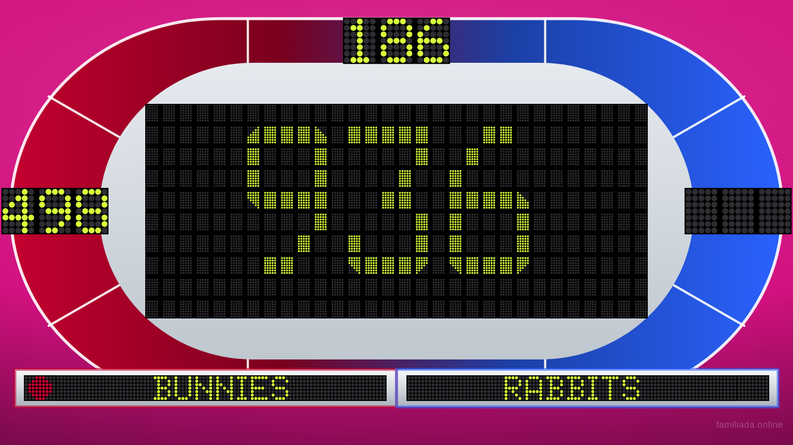

### Wyświetlacz — koniec gry: wygrana kwota — uk · 1600×900

### Wyświetlacz — koniec gry bez finału: punkty zwycięzców — pl · 1600×900

### Wyświetlacz — koniec gry bez finału: punkty zwycięzców — en · 1600×900

### Wyświetlacz — koniec gry bez finału: punkty zwycięzców — uk · 1600×900

### Wyświetlacz — koniec gry: logo (remis) — pl · 1600×900

### Wyświetlacz — koniec gry: logo (remis) — en · 1600×900

### Wyświetlacz — koniec gry: logo (remis) — uk · 1600×900

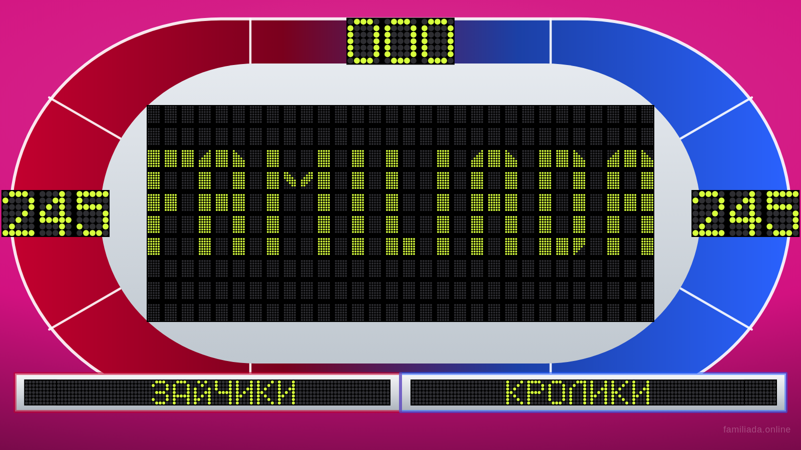
